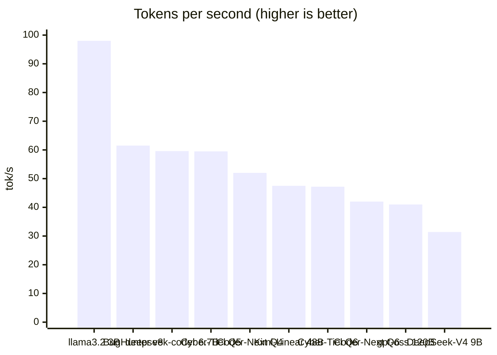

# Supported and tested models

  <strong>Which models actually work on a DGX Spark, and which one to pick for each task.</strong> 
  Results measured with MyDGX Benchmarks on an NVIDIA DGX Spark (GB10, 128 GB of unified memory) · November 14–24, 2026

  <strong>47 measured results</strong> ·
  <strong>29 text</strong> ·
  <strong>10 vision</strong> ·
  <strong>5 speech synthesis</strong> ·
  <strong>2 transcription</strong> ·
  <strong>1 image</strong>

Every figure on this page comes from running each model on the Spark itself,
one at a time and with the same tests. They are not catalog data or estimates.
The only exception is [Inkling 2 Mini](#awaiting-benchmark), which doesn't have a
MyDGX benchmark yet and is listed separately.

- [Which one should I pick?](#which-one-should-i-pick)
- [How to read the tables](#how-to-read-the-tables)
- [Text model ranking](#text-model-ranking)
- [Awaiting benchmark](#awaiting-benchmark)
- [Voice, image, and vision](#voice-image-and-vision)
- [Quick glossary](#quick-glossary)
- [How it was measured](#how-it-was-measured)

## Which one should I pick?

| If you want… | Try | Why |
|---|---|---|
| ⚡ **Instant answers** | [llama3.2:3b](https://ollama.com/library/llama3.2) | 98 tokens per second and takes up only 2 GB. Ideal for quick questions. |
| 🧠 **A good all-round assistant** | [Kimi-Linear-48B-A3B-Instruct](https://huggingface.co/bartowski/moonshotai_Kimi-Linear-48B-A3B-Instruct-GGUF) | The best balance between intelligence and speed: 47 tok/s with a 48B model. |
| 💻 **Coding** | [Cyber-Tiel-Coder-35B-A3B Q5 + MTP](https://huggingface.co/peculiar-ragdoll/Cyber-Tiel-Coder-35B-A3B-GGUF) | Built for code, reasons, and with its MTP drafter reaches 59 tok/s in 27 GB. |
| 🛡️ **Cybersecurity** | [BugHunter v8 (Qwen3.5-35B-A3B)](https://huggingface.co/mmp2055/Qwen3.5-35B-A3B-uncensored-bughunter-v8) | Web and API bug bounty; the fastest Hugging Face text model measured (61 tok/s) in just 21 GB. |
| 🤖 **Agents with visible reasoning** (Claude Code, OpenCode) | [Inkling 2 Mini](https://huggingface.co/ggml-org/Inkling-2-Mini-GGUF) | Reasons, calls tools, and sees images, with 64K of context in MyDGX. No MyDGX score yet: see [awaiting benchmark](#awaiting-benchmark). |
| 🏋️ **The most powerful model that fits** | [gpt-oss-120b-Derestricted](https://huggingface.co/gghfez/gpt-oss-120b-Derestricted.MXFP4_MOE-gguf) | 117B parameters and still 41 tok/s thanks to its MoE architecture. |
| 👁️ **Describe images** | [Gemma-4-31B heretic](https://huggingface.co/llmfan46/gemma-4-31B-it-uncensored-heretic-GGUF) | The only one that recognizes every concept in the vision test. |
| 🎙️ **Transcribe audio** | [whisper-large-v3-turbo](https://huggingface.co/openai/whisper-large-v3-turbo) | Transcribes 12 s of audio in 0.16 s. |
| 🗣️ **Convert text to speech** | [OmniVoice](https://huggingface.co/k2-fsa/OmniVoice) | Perfectly intelligible voice and the fastest of those tested. |
| 🎨 **Generate images** | [FLUX.1 Schnell FP8](https://huggingface.co/Comfy-Org/flux1-schnell) | One image in 1 second, always the same with the same seed. |

> [!TIP]
> If you don't know where to start, start **Kimi-Linear-48B-A3B-Instruct** from
> *Models* and try it in *Chat*. If memory is tight because you have other
> models loaded, use **llama3.2:3b**.

## How to read the tables

| Column | What it means | What's good? |
|---|---|---|
| **Score** | MyDGX score from 0 to 100 that combines speed, time to first response, stability, and reliability. | The higher, the better. |
| **Speed** | Tokens per second (tok/s). A token is roughly half a word. | 🟢 40 or more: instant · 🟡 15–40: smooth · 🟠 6–15: comfortable to read · 🔴 under 6: slow |
| **First response** | How long it takes to start writing after you send the question. | Under 0.5 s feels immediate. |
| **Size** | How much space the model takes on disk. It needs roughly the same in memory, plus a bit for the context. | The Spark has 128 GB; leave headroom for the system. |
| **Parameters** | The model's "brain size". In MoE models only a part (the *active* ones) works on each word. | More parameters usually means more quality; few active ones mean more speed. |
| **Quantization** | How much the model has been compressed so it fits. | `Q8_0` loses almost no quality; `Q4` and `IQ3` compress more. |

Next to each model's name:

- **🧠** — the model can reason before answering. It's the same *Reasoning*
  badge MyDGX shows in *Models* and in profiles, and it comes from the GGUF's
  own chat template. A colored badge means the model reasons by default; a
  grey one means the client turns it on per request. Details in
  [Reasoning](api.md#reasoning).
- **⚡ MTP** — measured with speculative decoding on (see the
  [glossary](#quick-glossary)).

## Text model ranking

Chat, coding, and reasoning models sorted by MyDGX score.

| # | Model | Score | Speed (tok/s) | First response | Size | Parameters | Quantization | Source |
|:-:|---|:-:|---|:-:|:-:|---|:-:|:-:|
| 🥇 | **[llama3.2:3b](https://ollama.com/library/llama3.2)** Fast assistant for simple tasks (it's the MyDGX assistant's model) | **99** | 🟢 98.0 ▰▰▰▰▰▰▰▰▰▰ | 0.04 s | 2.0 GB | 3B | `Q4_K_M` | Ollama |
| 🥈 | **[BugHunter v8](https://huggingface.co/mmp2055/Qwen3.5-35B-A3B-uncensored-bughunter-v8)** 🧠 Web and API bug bounty, uncensored | **95** | 🟢 61.5 ▰▰▰▰▰▰▱▱▱▱ | 0.07 s | 21.2 GB | 35B · 3B active | `Q4_K_M` | Hugging Face |
| 🥉 | **[deepseek-coder:6.7b](https://ollama.com/library/deepseek-coder)** Lightweight coding and autocomplete | **95** | 🟢 59.6 ▰▰▰▰▰▰▱▱▱▱ | 0.05 s | 3.8 GB | 6.7B | `Q4_0` | Ollama |
| 4 | **[Cyber-Tiel-Coder-35B-A3B](https://huggingface.co/peculiar-ragdoll/Cyber-Tiel-Coder-35B-A3B-GGUF)** 🧠 Coding and cybersecurity, uncensored · ⚡ MTP | **94** | 🟢 59.5 ▰▰▰▰▰▰▱▱▱▱ | 0.11 s | 26.6 GB | 35B · 3B active | `UD-Q5_K_XL` | Hugging Face |
| 5 | **[Qwen3-Coder-Next abliterated](https://huggingface.co/bartowski/huihui-ai_Qwen3-Coder-Next-abliterated-GGUF)** Agentic coding, uncensored | **94** | 🟢 52.0 ▰▰▰▰▰▱▱▱▱▱ | 0.08 s | 48.6 GB | 80B · 3B active | `Q4_K_M` | Hugging Face |
| 6 | **[Kimi-Linear-48B-A3B-Instruct](https://huggingface.co/bartowski/moonshotai_Kimi-Linear-48B-A3B-Instruct-GGUF)** General assistant with very long context | **93** | 🟢 47.5 ▰▰▰▰▰▱▱▱▱▱ | 0.07 s | 40.6 GB | 48B · 3B active | `Q6_K_L` | Hugging Face |
| 7 | **[Cyber-Tiel-Coder-35B-A3B](https://huggingface.co/peculiar-ragdoll/Cyber-Tiel-Coder-35B-A3B-GGUF)** 🧠 Less compressed version · ⚡ MTP | **93** | 🟢 47.2 ▰▰▰▰▰▱▱▱▱▱ | 0.07 s | 31.8 GB | 35B · 3B active | `UD-Q6_K_XL` | Hugging Face |
| 8 | **[Qwen3-Coder-Next abliterated](https://huggingface.co/bartowski/huihui-ai_Qwen3-Coder-Next-abliterated-GGUF)** Less compressed version | **92** | 🟢 42.0 ▰▰▰▰▱▱▱▱▱▱ | 0.09 s | 65.7 GB | 80B · 3B active | `Q6_K_L` | Hugging Face |
| 9 | **[gpt-oss-120b-Derestricted](https://huggingface.co/gghfez/gpt-oss-120b-Derestricted.MXFP4_MOE-gguf)** 🧠 Large OpenAI generalist, unrestricted | **90** | 🟢 41.0 ▰▰▰▰▱▱▱▱▱▱ | 0.18 s | 63.4 GB | 116.8B · 5.1B active | `MXFP4` | Hugging Face |
| 10 | **[DeepSeek-V4-Pro-Qwen3.5-9B heretic](https://huggingface.co/mradermacher/DeepSeek-V4-Pro-Qwen3.5-9B-UNCENSORED-heretic-GGUF)** 🧠 Compact reasoning, uncensored · ⚡ MTP | **90** | 🟡 31.4 ▰▰▰▱▱▱▱▱▱▱ | 0.10 s | 9.8 GB | 9B | `Q8_0` | Hugging Face |
| 11 | **[BaronLLM (Llama 3.1 8B)](https://huggingface.co/AlicanKiraz0/Cybersecurity-BaronLLM_Offensive_Security_LLM_Q6_K_GGUF)** Offensive cybersecurity | **88** | 🟡 25.3 ▰▰▰▱▱▱▱▱▱▱ | 0.08 s | 6.6 GB | 8B | `Q6_K` | Hugging Face |
| 12 | **[Qwen3.8-Flash-Next abliterated](https://huggingface.co/SC117/Qwen3.8-Flash-Next-GSQ-RCO-abliterated-GGUF)** 🧠 Large generalist, uncensored | **88** | 🟡 25.5 ▰▰▰▱▱▱▱▱▱▱ | 0.11 s | 76.1 GB | MoE · n/a | `IQ3_XXS` | Hugging Face |
| 13 | **[Bimo-7B-CyberAgent](https://huggingface.co/mradermacher/Bimo-7B-CyberAgent-GGUF)** Lightweight cybersecurity agent | **87** | 🟡 21.0 ▰▰▱▱▱▱▱▱▱▱ | 0.07 s | 8.1 GB | 7B | `Q8_0` | Hugging Face |
| 14 | **[Qwen3.8-Flash-Next](https://huggingface.co/unsloth/Qwen3.8-Flash-Next-GGUF)** 🧠 Large generalist | **87** | 🟡 25.5 ▰▰▰▱▱▱▱▱▱▱ | 0.19 s | 83.6 GB | MoE · n/a | `UD-IQ3_XXS` | Hugging Face |
| 15 | **[Qwen3-14B-BaronLLM-v2](https://huggingface.co/AlicanKiraz0/Qwen3-14B-BaronLLM-v2-Q4_0-GGUF)** 🧠 Offensive cybersecurity | **86** | 🟡 19.2 ▰▰▱▱▱▱▱▱▱▱ | 0.07 s | 8.5 GB | 14B | `Q4_0` | Hugging Face |
| 16 | **[OrcaCyber-Nano-1.0](https://huggingface.co/orcarouter/OrcaCyber-Nano-1.0)** 🧠 Defense, DFIR, and log analysis · ⚡ MTP | **86** | 🟡 21.0 ▰▰▱▱▱▱▱▱▱▱ | 0.18 s | 15.7 GB | 27B | `AI-Defense-Mix` | Hugging Face |
| 17 | **[BugHunter v7 (Qwen3.8-27B)](https://huggingface.co/mmp2055/Qwen3.8-27B-Uncensored-bughunter-v7)** 🧠 Bug bounty, uncensored · ⚡ MTP | **85** | 🟡 20.4 ▰▰▱▱▱▱▱▱▱▱ | 0.20 s | 16.8 GB | 27B | `Q4_K_M` | Hugging Face |
| 18 | **[Qwen3.8-27B](https://huggingface.co/unsloth/Qwen3.8-27B-GGUF)** 🧠 Mid-size generalist (RAGKit's model) · ⚡ MTP | **83** | 🟡 16.1 ▰▰▱▱▱▱▱▱▱▱ | 0.22 s | 22.0 GB | 27B | `UD-Q6_K` | Hugging Face |
| 19 | **[GLM-5.3-Flash](https://huggingface.co/unsloth/GLM-5.3-Flash-GGUF)** 🧠 Very large generalist | **83** | 🟡 16.1 ▰▰▱▱▱▱▱▱▱▱ | 0.20 s | 101.8 GB | MoE · n/a | `UD-IQ2_XXS` | Hugging Face |
| 20 | **[GLM-5.3-Flash Uncensored](https://huggingface.co/BoldingBuilds/orcarouter_GLM-5.3-Flash-Uncensored-GGUF)** 🧠 Very large generalist, uncensored | **82** | 🟠 12.7 ▰▱▱▱▱▱▱▱▱▱ | 0.19 s | 97.1 GB | MoE · n/a | `IQ2_XXS` | Hugging Face |
| 21 | **[Gemma-4-12B heretic](https://huggingface.co/igorls/gemma-4-12B-it-heretic-GGUF)** 🧠 General conversation, uncensored | **78** | 🟠 12.4 ▰▱▱▱▱▱▱▱▱▱ | 0.43 s | 12.7 GB | 12B | `Q8_0` | Hugging Face |
| 22 | **[Qwen3.8-27B abliterated](https://huggingface.co/Blackfrost-AI/Qwen3.8-27B-ABLITERATED-GGUF)** 🧠 Mid-size generalist, uncensored | **78** | 🟠 7.4 ▰▱▱▱▱▱▱▱▱▱ | 0.21 s | 22.4 GB | 27B | `Q6_K` | Hugging Face |
| 23 | **[Dolphin-Mistral-24B Venice](https://huggingface.co/bartowski/cognitivecomputations_Dolphin-Mistral-24B-Venice-Edition-GGUF)** Open conversation, uncensored | **78** | 🟠 6.6 ▰▱▱▱▱▱▱▱▱▱ | 0.18 s | 25.1 GB | 24B | `Q8_0` | Hugging Face |
| 24 | **[Qwen3.8-27B Uncensored Cyber](https://huggingface.co/philbert440/Qwen3.8-27B-Uncensored-Cyber-GGUF)** 🧠 Cybersecurity, uncensored | **77** | 🟠 6.9 ▰▱▱▱▱▱▱▱▱▱ | 0.21 s | 23.7 GB | 27B | `Q6_K` | Hugging Face |
| 25 | **[Assistant Pepe 70B](https://huggingface.co/bartowski/SicariusSicariiStuff_Assistant_Pepe_70B-GGUF)** Conversation and role-play | **72** | 🔴 3.7 ▰▱▱▱▱▱▱▱▱▱ | 0.31 s | 44.0 GB | 70B | `Q4_K_M` | Hugging Face |
| 26 | **[Qwen3.8-40B Ultimate Heretic](https://huggingface.co/DavidAU/Qwen3.8-40B-Ultimate-Heretic-Uncensored-Turbo-Brilliance-50x-AGI-NEO-GGUF)** 🧠 Creative reasoning, uncensored | **71** | 🔴 3.9 ▰▱▱▱▱▱▱▱▱▱ | 0.39 s | 42.0 GB | 40B | `Q8_0` | Hugging Face |
| 27 | **[Assistant Pepe 70B](https://huggingface.co/bartowski/SicariusSicariiStuff_Assistant_Pepe_70B-GGUF)** Conversation and role-play, less compressed version | **69** | 🔴 2.7 ▰▱▱▱▱▱▱▱▱▱ | 0.41 s | 60.6 GB | 70B | `Q6_K` | Hugging Face |
| 28 | **[Gemma-4-31B heretic](https://huggingface.co/llmfan46/gemma-4-31B-it-uncensored-heretic-GGUF)** 🧠 General conversation, uncensored | **69** | 🟠 6.3 ▰▱▱▱▱▱▱▱▱▱ | 0.85 s | 25.2 GB | 31B | `Q6_K` | Hugging Face |
| 29 | **[Kimi-Dev-72B](https://huggingface.co/unsloth/Kimi-Dev-72B-GGUF)** Coding (issue resolution) | **68** | 🔴 2.6 ▰▱▱▱▱▱▱▱▱▱ | 0.42 s | 64.3 GB | 72B | `Q6_K` | Hugging Face |

The speed bar goes from 0 to 100 tok/s. "MoE · n/a": mixture-of-experts model whose
parameter count isn't listed in its metadata.

### Speed of the 10 fastest

> [!NOTE]
> **Why is a 120B model faster than a 27B one?** **MoE** models
> (such as gpt-oss-120b, Kimi-Linear, or Cyber-Tiel) only activate a small
> part of their parameters for each word, so they read much less memory. On
> the Spark that matters more than the total size: a 117B MoE with 5B active is
> more than two and a half times faster than a dense 27B model, even with MTP.

> [!TIP]
> **MTP doubles the speed of dense models.** Qwen3.8-27B went from 7.3 to
> 16.1 tok/s and DeepSeek-V4-Pro 9B from 18.1 to 31.4 tok/s when measured with
> their MTP drafter. MyDGX only turns it on when it finds the model's drafter.

## Awaiting benchmark

Models already integrated in MyDGX that don't have a MyDGX score yet. The
figures come from a manual test on the same Spark and aren't comparable with
the ranking.

| Model | Manual test | Size | Parameters | Quantization | Requirements |
|---|---|:-:|---|:-:|---|
| **[Inkling 2 Mini](https://huggingface.co/ggml-org/Inkling-2-Mini-GGUF)** 🧠 👁️ Agents and coding; reasons, uses tools, and sees images | 23.7 tok/s generating 700 tokens; passes chat, tools, the Anthropic API, the Responses API, and vision through the gateway | 27.8 GB | 26.4B · 3.4B active (middle layers ×3) | `Q8_0` | llama.cpp b12669 or later |

Inkling 2 Mini runs its middle layers three times per token, so it reads
about 5.4B of weights per token: that's why it isn't faster than a 3B-active
MoE. Its reasoning is set with `reasoning_effort` (from `none` to `max`) and,
according to its model card, it still writes a short reasoning even at
`none`.

## Voice, image, and vision

### 🎙️ Speech transcription (audio to text)

| # | Model | Score | Word error | Time for 12 s of audio | Size |
|:-:|---|:-:|:-:|:-:|:-:|
| 🥇 | **[whisper-large-v3-turbo](https://huggingface.co/openai/whisper-large-v3-turbo)** | **92** | 11 % | 0.16 s (73× faster than the audio) | 1.6 GB |
| 🥈 | **[faster-whisper-large-v3-turbo](https://huggingface.co/dropbox-dash/faster-whisper-large-v3-turbo)** | **92** | 11 % | 0.28 s (42× faster than the audio) | 1.6 GB |

### 🗣️ Speech synthesis (text to speech)

Intelligibility is checked by transcribing the generated speech with Whisper: 100 %
means every word was understood.

| # | Model | Score | Intelligibility | Speed | Size |
|:-:|---|:-:|:-:|:-:|:-:|
| 🥇 | **[OmniVoice](https://huggingface.co/k2-fsa/OmniVoice)** | **100** | 100 % | 4× real time | 3.3 GB |
| 🥈 | **[F5-TTS](https://huggingface.co/SWivid/F5-TTS)** | **100** | 100 % | 3.3× real time | 6.7 GB |
| 🥉 | **[Qwen3-TTS-12Hz-0.6B-Base](https://huggingface.co/Qwen/Qwen3-TTS-12Hz-0.6B-Base)** | **100** | 100 % | 1.9× real time | 2.5 GB |
| 4 | **[Qwen3-TTS-12Hz-1.7B-Base](https://huggingface.co/Qwen/Qwen3-TTS-12Hz-1.7B-Base)** | **100** | 100 % | 1.5× real time | 4.5 GB |
| 5 | **[Chatterbox](https://huggingface.co/ResembleAI/chatterbox)** | **81** | 62 % | 1.7× real time | 13.9 GB |

"4× real time" means it generates 4 seconds of speech in 1 second.

### 🎨 Image generation

| Model | Score | Time per image | Reproducible | Size |
|---|:-:|:-:|:-:|:-:|
| **[FLUX.1 Schnell FP8](https://huggingface.co/Comfy-Org/flux1-schnell)** | **100** | 1.0 s | ✅ same seed, same image | 17.2 GB |

### 👁️ Vision (describing images)

| # | Model | Score | Concepts recognized | Time per image | Size |
|:-:|---|:-:|:-:|:-:|:-:|
| 🥇 | **[Gemma-4-31B heretic](https://huggingface.co/llmfan46/gemma-4-31B-it-uncensored-heretic-GGUF)** | **81** | 100 % | 15.8 s | 25.2 GB |
| 🥈 | **[Huihui-Qwen3.5-0.8B abliterated](https://huggingface.co/azminawwar/huihui-ai_Huihui-Qwen3.5-0.8B-abliterated_Ultimate-Offensive-Red-Team)** | **61** | 50 % | 1.1 s | 0.8 GB |
| 🥉 | **[Qwen3.8-Flash-Next](https://huggingface.co/unsloth/Qwen3.8-Flash-Next-GGUF)** | **56** | 50 % | 2.8 s | 83.6 GB |
| 4 | **[Qwen3.8-Flash-Next abliterated](https://huggingface.co/SC117/Qwen3.8-Flash-Next-GSQ-RCO-abliterated-GGUF)** | **56** | 50 % | 2.9 s | 76.1 GB |
| 5 | **[GLM-5.3-Flash](https://huggingface.co/unsloth/GLM-5.3-Flash-GGUF)** | **54** | 50 % | 4.3 s | 101.8 GB |
| 6 | **[GLM-5.3-Flash Uncensored](https://huggingface.co/BoldingBuilds/orcarouter_GLM-5.3-Flash-Uncensored-GGUF)** | **53** | 50 % | 4.9 s | 97.1 GB |
| 7 | **[OrcaCyber-Nano-1.0](https://huggingface.co/orcarouter/OrcaCyber-Nano-1.0)** | **51** | 50 % | 6.4 s | 15.7 GB |
| 8 | **[Qwen3.8-27B Uncensored Cyber](https://huggingface.co/philbert440/Qwen3.8-27B-Uncensored-Cyber-GGUF)** | **48** | 50 % | 9.0 s | 23.7 GB |
| 9 | **[Qwen3.8-27B abliterated](https://huggingface.co/Blackfrost-AI/Qwen3.8-27B-ABLITERATED-GGUF)** | **46** | 50 % | 13.9 s | 22.4 GB |
| 10 | **[DeepSeek-V4-Pro-Qwen3.5-9B heretic](https://huggingface.co/mradermacher/DeepSeek-V4-Pro-Qwen3.5-9B-UNCENSORED-heretic-GGUF)** | **46** | 50 % | 18.5 s | 9.8 GB |

Time per image is the median and includes the reasoning of models that
reason. In llama.cpp vision doesn't combine with MTP, so these were measured
without a drafter. OrcaCyber-Nano-1.0 is a restricted-access (*gated*)
repository: you have to accept its terms on Hugging Face and save a token in
*Settings* before downloading it.

## Quick glossary

| Term | In a nutshell |
|---|---|
| **Token** | A piece of text, roughly half a word. We read at about 5–8 tokens per second. |
| **Parameters (B)** | Billions of "connections" in the model. 3B is small; 70B or more, large. |
| **MoE** | *Mixture of Experts*: the model has many "experts" and only uses a few for each word. Fast even when it's huge. |
| **Reasoning** | Some models write out a reasoning before the answer. It's part of the model's training, not an add-on: the chat template only decides whether it's on (`enable_thinking`, `reasoning_effort`). The MyDGX gateway translates it from the OpenAI, Anthropic, and Responses APIs. Reasoning improves hard answers, but costs time: those tokens are generated too. |
| **Speculative decoding** | A small model (the *drafter*) proposes several tokens and the big one checks them in one pass. When it guesses right, the answer comes out faster with the same quality. |
| **Drafter** | The small model that proposes the tokens. It must share the main model's vocabulary (Qwen3-Coder-Next, for example, has no compatible drafter installed), and MTP drafters only work with the model they were trained for. In llama.cpp it doesn't combine with vision (`mmproj`), so MyDGX picks the drafter unless you ask for vision. |
| **MTP** | *Multi-Token Prediction*: a drafter built into the GGUF or shipped as a separate file (`mtp-*.gguf`). On the Spark it accepts between 44 % and 62 % of the proposed tokens and doubles the speed of dense 27B models. MyDGX only turns it on when it finds the drafter. |
| **Quantization** | Model compression. `Q8_0` ≈ original; `Q6_K` very good; `Q4` a good balance; `IQ2`/`IQ3` heavy compression so giant models fit. |
| **GGUF** | The file format llama.cpp uses. It's the one that works best on the Spark. |
| **Ollama / Hugging Face** | Two places to download models from. MyDGX manages both from *Models*. |
| **Abliterated / Heretic / Uncensored** | Variants that have had their refusal filters removed. Use them responsibly. |
| **Gated** | A repository that requires accepting terms and a Hugging Face token to download. |

## How it was measured

- **Hardware:** NVIDIA DGX Spark with GB10 and 128 GB of unified memory (273 GB/s).
- **Engines:** llama.cpp built for GB10 (sm_121) for GGUF models, Ollama for
  its models, ComfyUI for images, and MyDGX's local voice services. MyDGX has
  used llama.cpp **b12669** since November 24, 2026; earlier measurements used
  v1.0.0. Qwen3.8-27B is already measured on b12669, and the rest are
  re-measured automatically when they're loaded.
- **Isolation:** before each measurement MyDGX frees memory, loads only that
  model, and warms it up, so nothing interferes.
- **Tests:** versioned protocols per task type, several repetitions, and
  only valid results (all samples correct). For text, it measures output
  speed, time to first token, and stability across
  repetitions.
- **What the score doesn't measure:** the quality of the answers for your specific case. A
  large, slow model may reason better than a small, fast one; use the
  ranking to see what is comfortable to use and test quality in *Chat*.

Results change with the llama.cpp version, the context, the quantization,
and the use of MTP. To see your own, open **Benchmarks** in MyDGX: every model
you download is measured automatically. Method details in
[Reproducible benchmarks](benchmarks.md).
