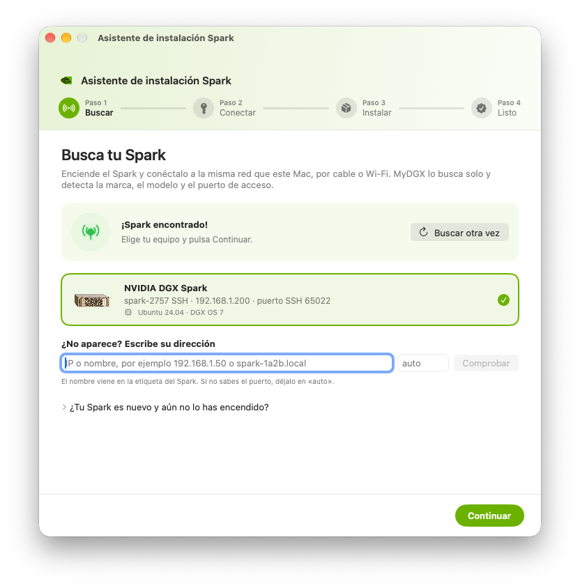
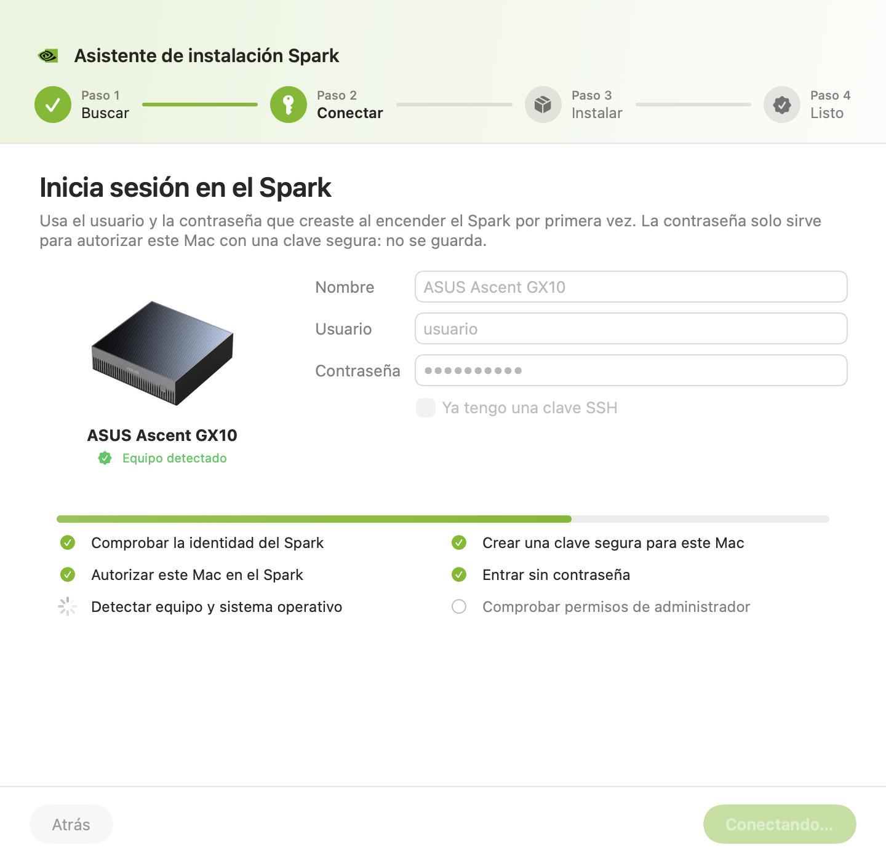
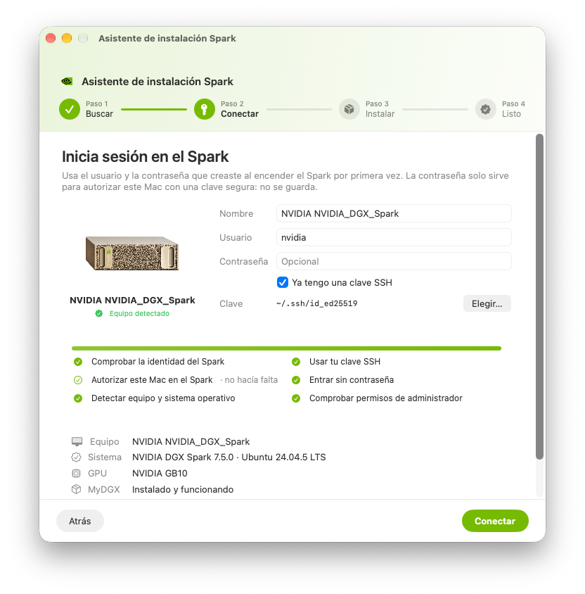
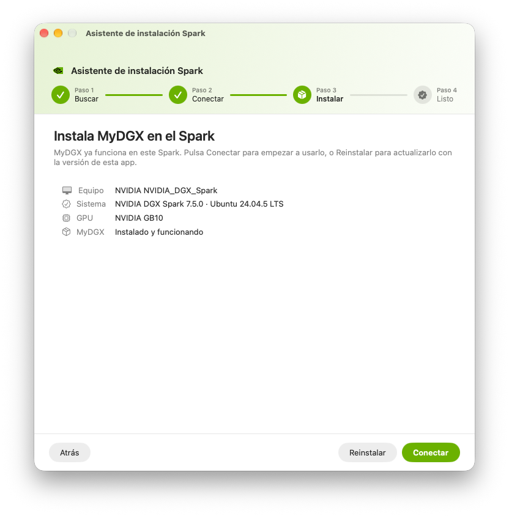
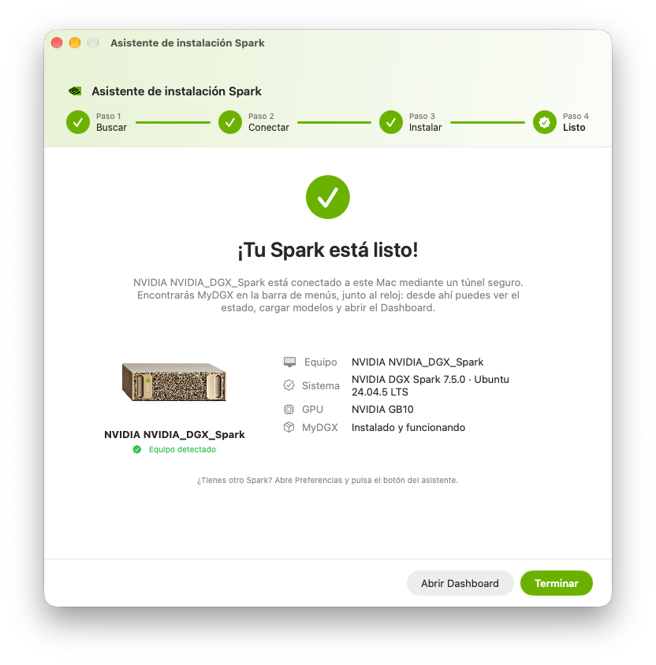

# Quick start: install MyDGX from macOS

This guide is meant for non-technical users. The first time you open
MyDGXTray, the **Spark Setup Assistant** opens on its own: it finds the Spark,
connects to it, installs MyDGX, and leaves you ready to use it, without opening
Terminal.

## Summary

1. Download MyDGXTray from [Releases](https://github.com/yadox666/MyDGX/releases)
   and move it to `Applications`.
2. Open it. The assistant appears automatically, and the menu only shows
   **Spark Setup Assistant…** until you finish it.
3. Follow its four steps: **Search**, **Connect**, **Install**, and **Done**.
4. Click **Open Dashboard**.

You don't need to download the source code or install Homebrew or Node.js: the
app includes MyDGX, and the Spark builds everything else.

## Before you start

You need:

- a Mac with macOS 13 or later, with Apple Silicon or Intel;
- a DGX Spark whose official first boot is already complete;
- the username and password created on the Spark (the user must be able to use
  `sudo`);
- both machines on the same network, or a reachable remote SSH address;
- an Internet connection during the first installation.

Don't open the dashboard, Open WebUI, or ComfyUI ports on your router. SSH is
enough for a remote connection; MyDGXTray creates the tunnels it needs.

## 1. Download from GitHub

1. Open [Releases](https://github.com/yadox666/MyDGX/releases) on GitHub.
2. Download `MyDGXTray-<version>-macos-universal.zip` and, if you want to verify
   the download, its `.sha256` too.
3. Unzip it and move **MyDGXTray** to `Applications`. The app already
   includes MyDGX: you don't need to download the source code.
4. Open MyDGXTray. If macOS blocks it the first time, go to **System
   Settings › Privacy & Security** and click **Open Anyway**.

To verify the download from Terminal, in the Downloads folder:

```bash
shasum -a 256 -c MyDGXTray-*-macos-universal.zip.sha256
```

It should reply `OK`. If you'd rather build it yourself, follow the
[MyDGXTray README](../../macos/MyDGXTray/README.md).

## 2. Step 1 · Search

### Local network permission

The first time, the assistant explains that macOS is going to ask for permission
and waits for you to click **Find my Spark**. The system prompt then appears:

> “MyDGX Tray” would like to find devices on your local networks.

Click **Allow**. Since macOS 15, this permission is required for any app that
searches for or connects to machines on your network, including the `ssh`
processes MyDGXTray launches, and it is only asked once. Without it, the app
can't find the Spark or connect to it over the local network. If you denied it,
the assistant detects this and offers **Open Local Network settings**: turn on
**MyDGX Tray** in **System Settings › Privacy & Security › Local Network** and
click **Search again**.

### Choose the Spark

The assistant searches your network for the Spark for a few seconds and shows it
with its brand and model (NVIDIA, ASUS, Lenovo, HP, Dell…), its address, the SSH
port and, if it can be determined before signing in, the operating system.

- If it appears, select it (it is already selected if there is only one) and
  click **Continue**.
- If it doesn't appear, type its IP or network name (it's on the label, for
  example `spark-1a2b.local`) and click **Check**. Leave the port on “auto”
  unless you know it's different: 22, 65022, and 2222 are tried.
- New Spark that hasn't been turned on yet? Expand **Is your Spark new and not
  started yet?** to open NVIDIA's official guide or prepare an OEMDATA USB drive.



## 3. Step 2 · Connect

Type the username and password you created during the Spark's first boot and
click **Connect**. A list with a progress bar shows each check:

1. Saves the Spark's identity (its SSH fingerprint) to `~/.MyDGX/known_hosts`.
2. Creates an Ed25519 key just for this Mac in `~/.MyDGX/keys`.
3. Authorizes that key on the Spark, using the password only once.
4. Signs in without a password.
5. Detects the brand, model, and operating system (DGX OS or Ubuntu).
6. Checks that the user can administer the machine (`sudo`).

If you already have an SSH key, check **I already have an SSH key** and choose the
private file (without `.pub`). The assistant won't let you continue if you choose
the public key or a file that isn't a key.
- If the Spark already accepts your key, the password is optional.
- If it doesn't accept it yet, type the password and the assistant authorizes it.
- If your key has a passphrase, the assistant asks for it once. It stores it in
  the macOS Keychain (`ssh-add --apple-use-keychain`), and MyDGXTray loads it at
  startup so the tunnel reconnects on its own.

If the user needs a password for `sudo` and you didn't type it here, step 3
asks for it before installing. The device name is filled in with the detected
model, and you can change it.



With your own key, the list marks the authorization as **not needed**, and the
detected details appear below it: device, system, GPU, and MyDGX status.



## 4. Step 3 · Install

Click **Install MyDGX**. The progress bar shows the percentage, the current
phase (copy MyDGX, prepare the system, build the AI engine, install apps
and services, start and verify), and the elapsed time. The first time it takes
between 20 and 40 minutes; the Mac doesn't go to sleep in the meantime.

When it finishes, the assistant saves the profile, opens the SSH tunnel, imports
the dashboard API key, and checks that everything responds. If MyDGX was already
installed and running, you'll see **Connect** (and **Reinstall** to update it).

If something fails, click **View detailed log** or **Retry**: anything already
installed is kept.



## 5. Step 4 · Done

The assistant shows a summary of the device. Click **Open Dashboard** or
**Finish**; the MyDGXTray menu now appears in full. From it you can open Open
WebUI, ComfyUI, SSH Terminal, and the profiles' web apps.



If the administrator enabled a web password, enter it on the dashboard's sign-in
screen.

### Another Spark or a remote server

Open **Settings** and click the **magic wand**: it's the same assistant. For a
remote server, type its domain or public IP and its SSH port in step 1.
If the Spark was already added, the assistant recognizes it by its SSH fingerprint,
its hostname, or its address and port. In that case it updates the existing profile
instead of duplicating it. You can then add a **Public IP or hostname (optional)** with the **Public/NAT port**
in Settings; the Tray tries the LAN first and switches to the Internet if it doesn't
respond. Access through a VPN is preferable. If you expose SSH directly, use
key-based authentication, disable passwords after verifying access, and
restrict the source with the firewall.

## Later updates

Install the new version of MyDGXTray from Releases, replacing the previous one
in `Applications`, and use:

**Settings → Deployment → Save and deploy**

The version of MyDGX bundled with the new app will be deployed.

This deployment is incremental: it keeps the Spark's `.env`, databases, models,
credentials, and caches.

### Stable public address with DuckDNS

Optionally, you can set `DUCKDNS_DOMAIN` and `DUCKDNS_TOKEN` directly in
the Spark's `.env` and run on the Mac, from the copy MyDGXTray leaves in
`~/.MyDGX/source` after the first deployment:

```bash
cd ~/.MyDGX/source
./start.sh deploy user@spark -p SSH_PORT -i KEY_PATH --duckdns --repair --interactive
```

Use the user, host, port, and private key path shown in the SSH section of the
profile in Settings.

MyDGX will install a timer that updates DuckDNS at boot and every hour.
Then use `your-name.duckdns.org` as the profile's **Public IP or hostname (optional)**.

## If something fails

- **It can't find the Spark:** check the **Local Network** permission (see Step 1),
  enter the IP manually, and verify that SSH is running and that both machines
  can communicate.
- **“The Spark doesn’t accept SSH passwords”:** use **I already have an SSH key**.
- **“The Spark’s identity doesn’t match”:** if you reinstalled it, delete its line
  from `~/.MyDGX/known_hosts` and connect again.
- **Undeployed:** open the assistant from Settings or use
  **Full first deployment…**.
- **Authentication required:** wait a few seconds; the Tray syncs its API key
  over SSH. The web dashboard may ask for a separate password.
- **The deployment fails:** click **View detailed log** in the assistant or
  **Open log** on the progress card in Settings.
- **The tunnel doesn't connect:** check the host, port, user, and SSH key in
  Settings.

## SECURITY NOTES

- Don't copy passwords, tokens, or private keys into the repository.
- Don't expose ports 8088, 3000, 4000, or 8188 directly to the Internet.
- The assistant saves the Spark's SSH fingerprint the first time and requires it
  afterwards; on untrusted networks, compare it with `ssh-keygen -lf /etc/ssh/ssh_host_ed25519_key.pub`
  run on the Spark itself.
- The Spark's password only lives in memory while the assistant uses it. On the
  Mac it reaches `ssh` through a private FIFO; it travels to the Spark over SSH's
  standard input, and `sudo` reads it from a 0600 file in `/dev/shm` (RAM) that is
  deleted when it finishes or fails. It never goes into arguments, environment
  variables, or logs.
- MyDGXTray stores API keys in `~/.MyDGX/credentials` and SSH keys in
  `~/.MyDGX/keys`, with restrictive permissions.
