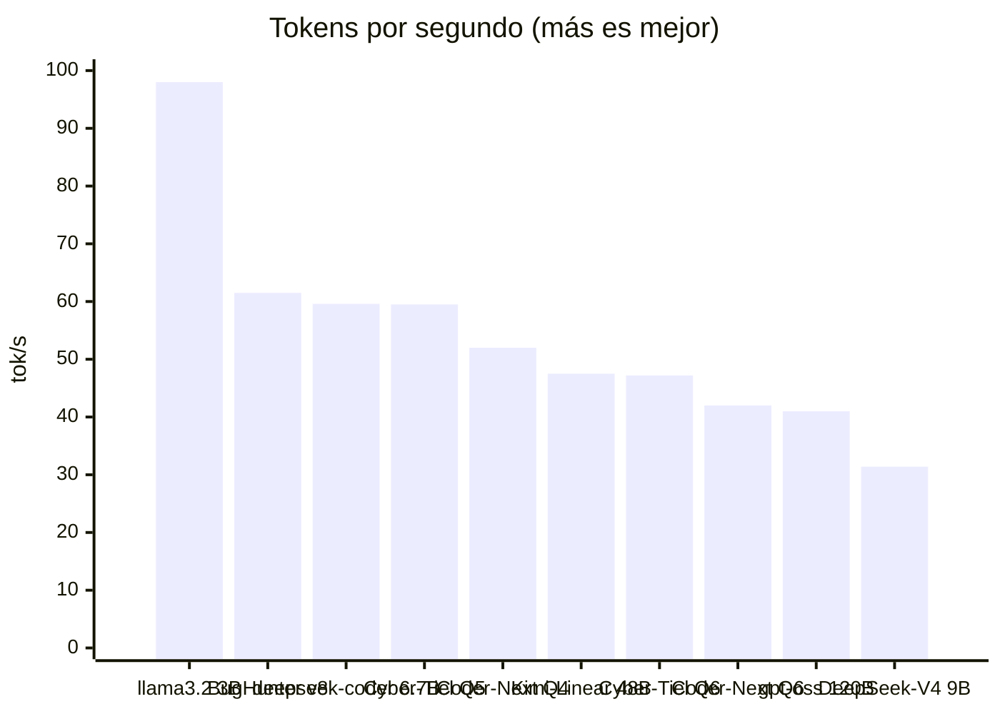

# Modelos soportados y probados

  <strong>Qué modelos funcionan de verdad en un DGX Spark y cuál elegir para cada tarea.</strong> 
  Resultados medidos con los Benchmarks de MyDGX en un NVIDIA DGX Spark (GB10, 128 GB de memoria unificada) · 14 a 24 de noviembre de 2026

  <strong>47 resultados medidos</strong> ·
  <strong>29 de texto</strong> ·
  <strong>10 de visión</strong> ·
  <strong>5 de voz sintética</strong> ·
  <strong>2 de transcripción</strong> ·
  <strong>1 de imagen</strong>

Todas las cifras de esta página salen de ejecutar cada modelo en el propio Spark,
de uno en uno y con las mismas pruebas. No son datos de catálogo ni estimaciones.
La única excepción es [Inkling 2 Mini](#pendientes-de-benchmark), que todavía
no tiene benchmark MyDGX y se indica aparte.

- [¿Cuál elijo?](#cuál-elijo)
- [Cómo leer las tablas](#cómo-leer-las-tablas)
- [Ranking de modelos de texto](#ranking-de-modelos-de-texto)
- [Pendientes de benchmark](#pendientes-de-benchmark)
- [Voz, imagen y visión](#voz-imagen-y-visión)
- [Glosario rápido](#glosario-rápido)
- [Cómo se ha medido](#cómo-se-ha-medido)

## ¿Cuál elijo?

| Si quieres… | Prueba | Por qué |
|---|---|---|
| ⚡ **Respuestas al instante** | [llama3.2:3b](https://ollama.com/library/llama3.2) | 98 tokens por segundo y ocupa solo 2 GB. Ideal para dudas rápidas. |
| 🧠 **Un buen asistente para todo** | [Kimi-Linear-48B-A3B-Instruct](https://huggingface.co/bartowski/moonshotai_Kimi-Linear-48B-A3B-Instruct-GGUF) | El mejor equilibrio entre inteligencia y velocidad: 47 tok/s con un modelo de 48B. |
| 💻 **Programar** | [Cyber-Tiel-Coder-35B-A3B Q5 + MTP](https://huggingface.co/peculiar-ragdoll/Cyber-Tiel-Coder-35B-A3B-GGUF) | Pensado para código, razona y con su drafter MTP llega a 59 tok/s en 27 GB. |
| 🛡️ **Ciberseguridad** | [BugHunter v8 (Qwen3.5-35B-A3B)](https://huggingface.co/mmp2055/Qwen3.5-35B-A3B-uncensored-bughunter-v8) | Bug bounty web y API; el texto más rápido de los medidos en Hugging Face (61 tok/s) en solo 21 GB. |
| 🤖 **Agentes con razonamiento visible** (Claude Code, OpenCode) | [Inkling 2 Mini](https://huggingface.co/ggml-org/Inkling-2-Mini-GGUF) | Razona, llama a herramientas y ve imágenes, con 64K de contexto en MyDGX. Aún sin score MyDGX: ver [pendientes](#pendientes-de-benchmark). |
| 🏋️ **El modelo más potente que cabe** | [gpt-oss-120b-Derestricted](https://huggingface.co/gghfez/gpt-oss-120b-Derestricted.MXFP4_MOE-gguf) | 117B de parámetros y aun así 41 tok/s gracias a su arquitectura MoE. |
| 👁️ **Describir imágenes** | [Gemma-4-31B heretic](https://huggingface.co/llmfan46/gemma-4-31B-it-uncensored-heretic-GGUF) | El único que reconoce todos los conceptos de la prueba de visión. |
| 🎙️ **Transcribir audio** | [whisper-large-v3-turbo](https://huggingface.co/openai/whisper-large-v3-turbo) | Transcribe 12 s de audio en 0,16 s. |
| 🗣️ **Convertir texto en voz** | [OmniVoice](https://huggingface.co/k2-fsa/OmniVoice) | Voz perfectamente inteligible y la más rápida de las probadas. |
| 🎨 **Generar imágenes** | [FLUX.1 Schnell FP8](https://huggingface.co/Comfy-Org/flux1-schnell) | Una imagen en 1 segundo, siempre igual con la misma semilla. |

> [!TIP]
> Si no sabes por dónde empezar, enciende **Kimi-Linear-48B-A3B-Instruct** desde
> *Modelos* y pruébalo en *Chat*. Si va justo de memoria porque tienes otros
> modelos cargados, usa **llama3.2:3b**.

## Cómo leer las tablas

| Columna | Qué significa | ¿Qué es bueno? |
|---|---|---|
| **Score** | Nota MyDGX de 0 a 100 que combina velocidad, rapidez de la primera respuesta, estabilidad y fiabilidad. | Cuanto más alto, mejor. |
| **Velocidad** | Tokens por segundo (tok/s). Un token es, más o menos, media palabra. | 🟢 40 o más: instantáneo · 🟡 15–40: fluido · 🟠 6–15: se lee cómodo · 🔴 menos de 6: lento |
| **Primera respuesta** | Cuánto tarda en empezar a escribir después de enviar la pregunta. | Menos de 0,5 s se nota inmediato. |
| **Tamaño** | Lo que ocupa el modelo en disco. Necesita más o menos lo mismo en memoria, más un poco para el contexto. | El Spark tiene 128 GB; deja margen para el sistema. |
| **Parámetros** | El "tamaño del cerebro" del modelo. En los MoE solo trabaja una parte (los *activos*) en cada palabra. | Más parámetros suele dar más calidad; pocos activos dan más velocidad. |
| **Cuantización** | Cuánto se ha comprimido el modelo para que quepa. | `Q8_0` casi no pierde calidad; `Q4` y `IQ3` comprimen más. |

Junto al nombre de cada modelo:

- **🧠** — el modelo puede razonar antes de responder. Es la misma insignia
  *Razonamiento* que muestra MyDGX en *Modelos* y en los perfiles, y sale de la
  plantilla de chat del propio GGUF. Si la insignia aparece en color, el
  modelo razona por defecto; si aparece gris, el cliente lo activa en cada
  petición. Detalles en [Razonamiento](api.md#razonamiento).
- **⚡ MTP** — medido con decodificación especulativa activa (ver
  [glosario](#glosario-rápido)).

## Ranking de modelos de texto

Modelos de chat, programación y razonamiento ordenados por score MyDGX.

| # | Modelo | Score | Velocidad (tok/s) | Primera respuesta | Tamaño | Parámetros | Cuantización | Origen |
|:-:|---|:-:|---|:-:|:-:|---|:-:|:-:|
| 🥇 | **[llama3.2:3b](https://ollama.com/library/llama3.2)** Asistente rápido para tareas sencillas (es el modelo del asistente MyDGX) | **99** | 🟢 98,0 ▰▰▰▰▰▰▰▰▰▰ | 0,04 s | 2,0 GB | 3B | `Q4_K_M` | Ollama |
| 🥈 | **[BugHunter v8](https://huggingface.co/mmp2055/Qwen3.5-35B-A3B-uncensored-bughunter-v8)** 🧠 Bug bounty web y API, sin censura | **95** | 🟢 61,5 ▰▰▰▰▰▰▱▱▱▱ | 0,07 s | 21,2 GB | 35B · 3B activos | `Q4_K_M` | Hugging Face |
| 🥉 | **[deepseek-coder:6.7b](https://ollama.com/library/deepseek-coder)** Programación ligera y autocompletado | **95** | 🟢 59,6 ▰▰▰▰▰▰▱▱▱▱ | 0,05 s | 3,8 GB | 6,7B | `Q4_0` | Ollama |
| 4 | **[Cyber-Tiel-Coder-35B-A3B](https://huggingface.co/peculiar-ragdoll/Cyber-Tiel-Coder-35B-A3B-GGUF)** 🧠 Programación y ciberseguridad, sin censura · ⚡ MTP | **94** | 🟢 59,5 ▰▰▰▰▰▰▱▱▱▱ | 0,11 s | 26,6 GB | 35B · 3B activos | `UD-Q5_K_XL` | Hugging Face |
| 5 | **[Qwen3-Coder-Next abliterated](https://huggingface.co/bartowski/huihui-ai_Qwen3-Coder-Next-abliterated-GGUF)** Programación agéntica, sin censura | **94** | 🟢 52,0 ▰▰▰▰▰▱▱▱▱▱ | 0,08 s | 48,6 GB | 80B · 3B activos | `Q4_K_M` | Hugging Face |
| 6 | **[Kimi-Linear-48B-A3B-Instruct](https://huggingface.co/bartowski/moonshotai_Kimi-Linear-48B-A3B-Instruct-GGUF)** Asistente general con contexto muy largo | **93** | 🟢 47,5 ▰▰▰▰▰▱▱▱▱▱ | 0,07 s | 40,6 GB | 48B · 3B activos | `Q6_K_L` | Hugging Face |
| 7 | **[Cyber-Tiel-Coder-35B-A3B](https://huggingface.co/peculiar-ragdoll/Cyber-Tiel-Coder-35B-A3B-GGUF)** 🧠 Versión menos comprimida · ⚡ MTP | **93** | 🟢 47,2 ▰▰▰▰▰▱▱▱▱▱ | 0,07 s | 31,8 GB | 35B · 3B activos | `UD-Q6_K_XL` | Hugging Face |
| 8 | **[Qwen3-Coder-Next abliterated](https://huggingface.co/bartowski/huihui-ai_Qwen3-Coder-Next-abliterated-GGUF)** Versión menos comprimida | **92** | 🟢 42,0 ▰▰▰▰▱▱▱▱▱▱ | 0,09 s | 65,7 GB | 80B · 3B activos | `Q6_K_L` | Hugging Face |
| 9 | **[gpt-oss-120b-Derestricted](https://huggingface.co/gghfez/gpt-oss-120b-Derestricted.MXFP4_MOE-gguf)** 🧠 Generalista grande de OpenAI, sin restricciones | **90** | 🟢 41,0 ▰▰▰▰▱▱▱▱▱▱ | 0,18 s | 63,4 GB | 116,8B · 5,1B activos | `MXFP4` | Hugging Face |
| 10 | **[DeepSeek-V4-Pro-Qwen3.5-9B heretic](https://huggingface.co/mradermacher/DeepSeek-V4-Pro-Qwen3.5-9B-UNCENSORED-heretic-GGUF)** 🧠 Razonamiento compacto, sin censura · ⚡ MTP | **90** | 🟡 31,4 ▰▰▰▱▱▱▱▱▱▱ | 0,10 s | 9,8 GB | 9B | `Q8_0` | Hugging Face |
| 11 | **[BaronLLM (Llama 3.1 8B)](https://huggingface.co/AlicanKiraz0/Cybersecurity-BaronLLM_Offensive_Security_LLM_Q6_K_GGUF)** Ciberseguridad ofensiva | **88** | 🟡 25,3 ▰▰▰▱▱▱▱▱▱▱ | 0,08 s | 6,6 GB | 8B | `Q6_K` | Hugging Face |
| 12 | **[Qwen3.8-Flash-Next abliterated](https://huggingface.co/SC117/Qwen3.8-Flash-Next-GSQ-RCO-abliterated-GGUF)** 🧠 Generalista grande, sin censura | **88** | 🟡 25,5 ▰▰▰▱▱▱▱▱▱▱ | 0,11 s | 76,1 GB | MoE · n/d | `IQ3_XXS` | Hugging Face |
| 13 | **[Bimo-7B-CyberAgent](https://huggingface.co/mradermacher/Bimo-7B-CyberAgent-GGUF)** Agente de ciberseguridad ligero | **87** | 🟡 21,0 ▰▰▱▱▱▱▱▱▱▱ | 0,07 s | 8,1 GB | 7B | `Q8_0` | Hugging Face |
| 14 | **[Qwen3.8-Flash-Next](https://huggingface.co/unsloth/Qwen3.8-Flash-Next-GGUF)** 🧠 Generalista grande | **87** | 🟡 25,5 ▰▰▰▱▱▱▱▱▱▱ | 0,19 s | 83,6 GB | MoE · n/d | `UD-IQ3_XXS` | Hugging Face |
| 15 | **[Qwen3-14B-BaronLLM-v2](https://huggingface.co/AlicanKiraz0/Qwen3-14B-BaronLLM-v2-Q4_0-GGUF)** 🧠 Ciberseguridad ofensiva | **86** | 🟡 19,2 ▰▰▱▱▱▱▱▱▱▱ | 0,07 s | 8,5 GB | 14B | `Q4_0` | Hugging Face |
| 16 | **[OrcaCyber-Nano-1.0](https://huggingface.co/orcarouter/OrcaCyber-Nano-1.0)** 🧠 Defensa, DFIR y análisis de logs · ⚡ MTP | **86** | 🟡 21,0 ▰▰▱▱▱▱▱▱▱▱ | 0,18 s | 15,7 GB | 27B | `AI-Defense-Mix` | Hugging Face |
| 17 | **[BugHunter v7 (Qwen3.8-27B)](https://huggingface.co/mmp2055/Qwen3.8-27B-Uncensored-bughunter-v7)** 🧠 Bug bounty, sin censura · ⚡ MTP | **85** | 🟡 20,4 ▰▰▱▱▱▱▱▱▱▱ | 0,20 s | 16,8 GB | 27B | `Q4_K_M` | Hugging Face |
| 18 | **[Qwen3.8-27B](https://huggingface.co/unsloth/Qwen3.8-27B-GGUF)** 🧠 Generalista mediano (el modelo de RAGKit) · ⚡ MTP | **83** | 🟡 16,1 ▰▰▱▱▱▱▱▱▱▱ | 0,22 s | 22,0 GB | 27B | `UD-Q6_K` | Hugging Face |
| 19 | **[GLM-5.3-Flash](https://huggingface.co/unsloth/GLM-5.3-Flash-GGUF)** 🧠 Generalista muy grande | **83** | 🟡 16,1 ▰▰▱▱▱▱▱▱▱▱ | 0,20 s | 101,8 GB | MoE · n/d | `UD-IQ2_XXS` | Hugging Face |
| 20 | **[GLM-5.3-Flash Uncensored](https://huggingface.co/BoldingBuilds/orcarouter_GLM-5.3-Flash-Uncensored-GGUF)** 🧠 Generalista muy grande, sin censura | **82** | 🟠 12,7 ▰▱▱▱▱▱▱▱▱▱ | 0,19 s | 97,1 GB | MoE · n/d | `IQ2_XXS` | Hugging Face |
| 21 | **[Gemma-4-12B heretic](https://huggingface.co/igorls/gemma-4-12B-it-heretic-GGUF)** 🧠 Conversación general, sin censura | **78** | 🟠 12,4 ▰▱▱▱▱▱▱▱▱▱ | 0,43 s | 12,7 GB | 12B | `Q8_0` | Hugging Face |
| 22 | **[Qwen3.8-27B abliterated](https://huggingface.co/Blackfrost-AI/Qwen3.8-27B-ABLITERATED-GGUF)** 🧠 Generalista mediano, sin censura | **78** | 🟠 7,4 ▰▱▱▱▱▱▱▱▱▱ | 0,21 s | 22,4 GB | 27B | `Q6_K` | Hugging Face |
| 23 | **[Dolphin-Mistral-24B Venice](https://huggingface.co/bartowski/cognitivecomputations_Dolphin-Mistral-24B-Venice-Edition-GGUF)** Conversación abierta, sin censura | **78** | 🟠 6,6 ▰▱▱▱▱▱▱▱▱▱ | 0,18 s | 25,1 GB | 24B | `Q8_0` | Hugging Face |
| 24 | **[Qwen3.8-27B Uncensored Cyber](https://huggingface.co/philbert440/Qwen3.8-27B-Uncensored-Cyber-GGUF)** 🧠 Ciberseguridad, sin censura | **77** | 🟠 6,9 ▰▱▱▱▱▱▱▱▱▱ | 0,21 s | 23,7 GB | 27B | `Q6_K` | Hugging Face |
| 25 | **[Assistant Pepe 70B](https://huggingface.co/bartowski/SicariusSicariiStuff_Assistant_Pepe_70B-GGUF)** Conversación y rol | **72** | 🔴 3,7 ▰▱▱▱▱▱▱▱▱▱ | 0,31 s | 44,0 GB | 70B | `Q4_K_M` | Hugging Face |
| 26 | **[Qwen3.8-40B Ultimate Heretic](https://huggingface.co/DavidAU/Qwen3.8-40B-Ultimate-Heretic-Uncensored-Turbo-Brilliance-50x-AGI-NEO-GGUF)** 🧠 Razonamiento creativo, sin censura | **71** | 🔴 3,9 ▰▱▱▱▱▱▱▱▱▱ | 0,39 s | 42,0 GB | 40B | `Q8_0` | Hugging Face |
| 27 | **[Assistant Pepe 70B](https://huggingface.co/bartowski/SicariusSicariiStuff_Assistant_Pepe_70B-GGUF)** Conversación y rol, versión menos comprimida | **69** | 🔴 2,7 ▰▱▱▱▱▱▱▱▱▱ | 0,41 s | 60,6 GB | 70B | `Q6_K` | Hugging Face |
| 28 | **[Gemma-4-31B heretic](https://huggingface.co/llmfan46/gemma-4-31B-it-uncensored-heretic-GGUF)** 🧠 Conversación general, sin censura | **69** | 🟠 6,3 ▰▱▱▱▱▱▱▱▱▱ | 0,85 s | 25,2 GB | 31B | `Q6_K` | Hugging Face |
| 29 | **[Kimi-Dev-72B](https://huggingface.co/unsloth/Kimi-Dev-72B-GGUF)** Programación (resolución de issues) | **68** | 🔴 2,6 ▰▱▱▱▱▱▱▱▱▱ | 0,42 s | 64,3 GB | 72B | `Q6_K` | Hugging Face |

La barra de velocidad va de 0 a 100 tok/s. "MoE · n/d": modelo de expertos cuyo
número de parámetros no figura en sus metadatos.

### Velocidad de los 10 más rápidos

> [!NOTE]
> **¿Por qué un modelo de 120B va más rápido que uno de 27B?** Los modelos
> **MoE** (como gpt-oss-120b, Kimi-Linear o Cyber-Tiel) solo activan una pequeña
> parte de sus parámetros en cada palabra, así que leen mucha menos memoria. En
> el Spark eso pesa más que el tamaño total: un MoE de 117B con 5B activos va
> más de dos veces y media más rápido que un modelo denso de 27B, incluso con
> MTP.

> [!TIP]
> **MTP duplica la velocidad de los modelos densos.** Qwen3.8-27B pasó de 7,3 a
> 16,1 tok/s y DeepSeek-V4-Pro 9B de 18,1 a 31,4 tok/s al medirlos con su
> drafter MTP. MyDGX lo activa solo cuando encuentra el drafter del modelo.

## Pendientes de benchmark

Modelos ya integrados en MyDGX que aún no tienen score MyDGX. Las cifras son de
una prueba manual en el mismo Spark y no son comparables con el ranking.

| Modelo | Prueba manual | Tamaño | Parámetros | Cuantización | Requisitos |
|---|---|:-:|---|:-:|---|
| **[Inkling 2 Mini](https://huggingface.co/ggml-org/Inkling-2-Mini-GGUF)** 🧠 👁️ Agentes y programación; razona, usa herramientas y ve imágenes | 23,7 tok/s generando 700 tokens; pasa chat, herramientas, API de Anthropic, API Responses y visión a través del gateway | 27,8 GB | 26,4B · 3,4B activos (capas centrales ×3) | `Q8_0` | llama.cpp b12669 o posterior |

Inkling 2 Mini repite sus capas centrales tres veces por token, así que lee
unos 5,4B de pesos por token: por eso no va más rápido que un MoE de 3B activos.
Su razonamiento se regula con `reasoning_effort` (de `none` a `max`) y, según
su ficha, incluso en `none` escribe un razonamiento corto.

## Voz, imagen y visión

### 🎙️ Transcripción de voz (audio a texto)

| # | Modelo | Score | Error de palabras | Tiempo para 12 s de audio | Tamaño |
|:-:|---|:-:|:-:|:-:|:-:|
| 🥇 | **[whisper-large-v3-turbo](https://huggingface.co/openai/whisper-large-v3-turbo)** | **92** | 11 % | 0,16 s (73× más rápido que el audio) | 1,6 GB |
| 🥈 | **[faster-whisper-large-v3-turbo](https://huggingface.co/dropbox-dash/faster-whisper-large-v3-turbo)** | **92** | 11 % | 0,28 s (42× más rápido que el audio) | 1,6 GB |

### 🗣️ Síntesis de voz (texto a voz)

La inteligibilidad se comprueba transcribiendo la voz generada con Whisper: 100 %
significa que se entendieron todas las palabras.

| # | Modelo | Score | Inteligibilidad | Velocidad | Tamaño |
|:-:|---|:-:|:-:|:-:|:-:|
| 🥇 | **[OmniVoice](https://huggingface.co/k2-fsa/OmniVoice)** | **100** | 100 % | 4× tiempo real | 3,3 GB |
| 🥈 | **[F5-TTS](https://huggingface.co/SWivid/F5-TTS)** | **100** | 100 % | 3,3× tiempo real | 6,7 GB |
| 🥉 | **[Qwen3-TTS-12Hz-0.6B-Base](https://huggingface.co/Qwen/Qwen3-TTS-12Hz-0.6B-Base)** | **100** | 100 % | 1,9× tiempo real | 2,5 GB |
| 4 | **[Qwen3-TTS-12Hz-1.7B-Base](https://huggingface.co/Qwen/Qwen3-TTS-12Hz-1.7B-Base)** | **100** | 100 % | 1,5× tiempo real | 4,5 GB |
| 5 | **[Chatterbox](https://huggingface.co/ResembleAI/chatterbox)** | **81** | 62 % | 1,7× tiempo real | 13,9 GB |

"4× tiempo real" quiere decir que genera 4 segundos de voz en 1 segundo.

### 🎨 Generación de imagen

| Modelo | Score | Tiempo por imagen | Reproducible | Tamaño |
|---|:-:|:-:|:-:|:-:|
| **[FLUX.1 Schnell FP8](https://huggingface.co/Comfy-Org/flux1-schnell)** | **100** | 1,0 s | ✅ misma semilla, misma imagen | 17,2 GB |

### 👁️ Visión (describir imágenes)

| # | Modelo | Score | Conceptos reconocidos | Tiempo por imagen | Tamaño |
|:-:|---|:-:|:-:|:-:|:-:|
| 🥇 | **[Gemma-4-31B heretic](https://huggingface.co/llmfan46/gemma-4-31B-it-uncensored-heretic-GGUF)** | **81** | 100 % | 15,8 s | 25,2 GB |
| 🥈 | **[Huihui-Qwen3.5-0.8B abliterated](https://huggingface.co/azminawwar/huihui-ai_Huihui-Qwen3.5-0.8B-abliterated_Ultimate-Offensive-Red-Team)** | **61** | 50 % | 1,1 s | 0,8 GB |
| 🥉 | **[Qwen3.8-Flash-Next](https://huggingface.co/unsloth/Qwen3.8-Flash-Next-GGUF)** | **56** | 50 % | 2,8 s | 83,6 GB |
| 4 | **[Qwen3.8-Flash-Next abliterated](https://huggingface.co/SC117/Qwen3.8-Flash-Next-GSQ-RCO-abliterated-GGUF)** | **56** | 50 % | 2,9 s | 76,1 GB |
| 5 | **[GLM-5.3-Flash](https://huggingface.co/unsloth/GLM-5.3-Flash-GGUF)** | **54** | 50 % | 4,3 s | 101,8 GB |
| 6 | **[GLM-5.3-Flash Uncensored](https://huggingface.co/BoldingBuilds/orcarouter_GLM-5.3-Flash-Uncensored-GGUF)** | **53** | 50 % | 4,9 s | 97,1 GB |
| 7 | **[OrcaCyber-Nano-1.0](https://huggingface.co/orcarouter/OrcaCyber-Nano-1.0)** | **51** | 50 % | 6,4 s | 15,7 GB |
| 8 | **[Qwen3.8-27B Uncensored Cyber](https://huggingface.co/philbert440/Qwen3.8-27B-Uncensored-Cyber-GGUF)** | **48** | 50 % | 9,0 s | 23,7 GB |
| 9 | **[Qwen3.8-27B abliterated](https://huggingface.co/Blackfrost-AI/Qwen3.8-27B-ABLITERATED-GGUF)** | **46** | 50 % | 13,9 s | 22,4 GB |
| 10 | **[DeepSeek-V4-Pro-Qwen3.5-9B heretic](https://huggingface.co/mradermacher/DeepSeek-V4-Pro-Qwen3.5-9B-UNCENSORED-heretic-GGUF)** | **46** | 50 % | 18,5 s | 9,8 GB |

El tiempo por imagen es la mediana e incluye el razonamiento de los modelos
que razonan. Estas medidas se hicieron sin drafter; llama.cpp ya combina la
visión con MTP, así que los modelos con drafter MTP pueden ir más rápido. OrcaCyber-Nano-1.0 es un repositorio con
acceso restringido (*gated*): hay que aceptar sus condiciones en Hugging Face y
guardar un token en *Configuración* antes de descargarlo.

## Glosario rápido

| Término | En pocas palabras |
|---|---|
| **Token** | Un trozo de texto, más o menos media palabra. Leemos a unos 5–8 tokens por segundo. |
| **Parámetros (B)** | Miles de millones de "conexiones" del modelo. 3B es pequeño; 70B o más, grande. |
| **MoE** | *Mixture of Experts*: el modelo tiene muchos "expertos" y en cada palabra solo usa unos pocos. Rápido aunque sea enorme. |
| **Razonamiento** | Algunos modelos escriben un razonamiento antes de la respuesta. Es entrenamiento del modelo, no un añadido: la plantilla de chat solo decide si se activa (`enable_thinking`, `reasoning_effort`). El gateway de MyDGX lo traduce desde las APIs de OpenAI, Anthropic y Responses. Razonar mejora las respuestas difíciles, pero cuesta tiempo: esos tokens también se generan. |
| **Decodificación especulativa** | Un modelo pequeño (*drafter*) propone varios tokens y el grande los comprueba de una vez. Si acierta, la respuesta sale más rápido sin cambiar su calidad. |
| **Drafter** | El modelo pequeño que propone los tokens. Debe compartir vocabulario con el principal (Qwen3-Coder-Next, por ejemplo, no tiene ninguno compatible instalado) y los MTP solo sirven para el modelo con el que se entrenaron. En llama.cpp, los drafters MTP funcionan junto a la visión (`mmproj`), así que MyDGX carga los dos. Los demás tipos de drafter solo funcionan sin visión, así que MyDGX los elige salvo que pidas visión. |
| **MTP** | *Multi-Token Prediction*: un drafter que viene dentro del GGUF o en un archivo aparte (`mtp-*.gguf`). En el Spark acepta entre el 44 % y el 62 % de los tokens propuestos y duplica la velocidad de los modelos densos de 27B. MyDGX lo activa solo si encuentra el drafter. |
| **Cuantización** | Compresión del modelo. `Q8_0` ≈ original; `Q6_K` muy bueno; `Q4` buen equilibrio; `IQ2`/`IQ3` mucha compresión para que quepan modelos gigantes. |
| **GGUF** | Formato de archivo que usa llama.cpp. Es el que mejor funciona en el Spark. |
| **Ollama / Hugging Face** | Dos sitios de donde descargar modelos. MyDGX gestiona los dos desde *Modelos*. |
| **Abliterated / Heretic / Uncensored** | Variantes a las que se les han quitado los filtros de rechazo. Úsalas con responsabilidad. |
| **Gated** | Repositorio que pide aceptar condiciones y un token de Hugging Face para descargar. |

## Cómo se ha medido

- **Equipo:** NVIDIA DGX Spark con GB10 y 128 GB de memoria unificada (273 GB/s).
- **Motores:** llama.cpp compilado para GB10 (sm_121) para los GGUF, Ollama para
  sus modelos, ComfyUI para imagen y los servicios locales de voz de MyDGX.
  MyDGX usa llama.cpp **b12669** desde el 24 de noviembre de 2026; las medidas
  anteriores se hicieron con v1.0.0. Qwen3.8-27B ya está medido con b12669, y
  el resto se vuelve a medir automáticamente cuando se carga.
- **Aislamiento:** antes de cada medida MyDGX libera la memoria, carga solo ese
  modelo y lo calienta, para que nada interfiera.
- **Pruebas:** protocolos versionados por tipo de tarea, varias repeticiones y
  solo resultados válidos (todas las muestras correctas). En texto se mide la
  velocidad de salida, el tiempo hasta el primer token y la estabilidad entre
  repeticiones.
- **Qué no mide el score:** la calidad de las respuestas en tu caso concreto. Un
  modelo grande y lento puede razonar mejor que uno pequeño y rápido; usa el
  ranking para saber qué es cómodo de usar y prueba la calidad en *Chat*.

Los resultados cambian con la versión de llama.cpp, el contexto, la
cuantización y el uso de MTP. Para ver los tuyos, abre **Benchmarks** en MyDGX:
cada modelo que descargas se mide automáticamente. Detalle del método en
[Benchmarks reproducibles](benchmarks.md).
