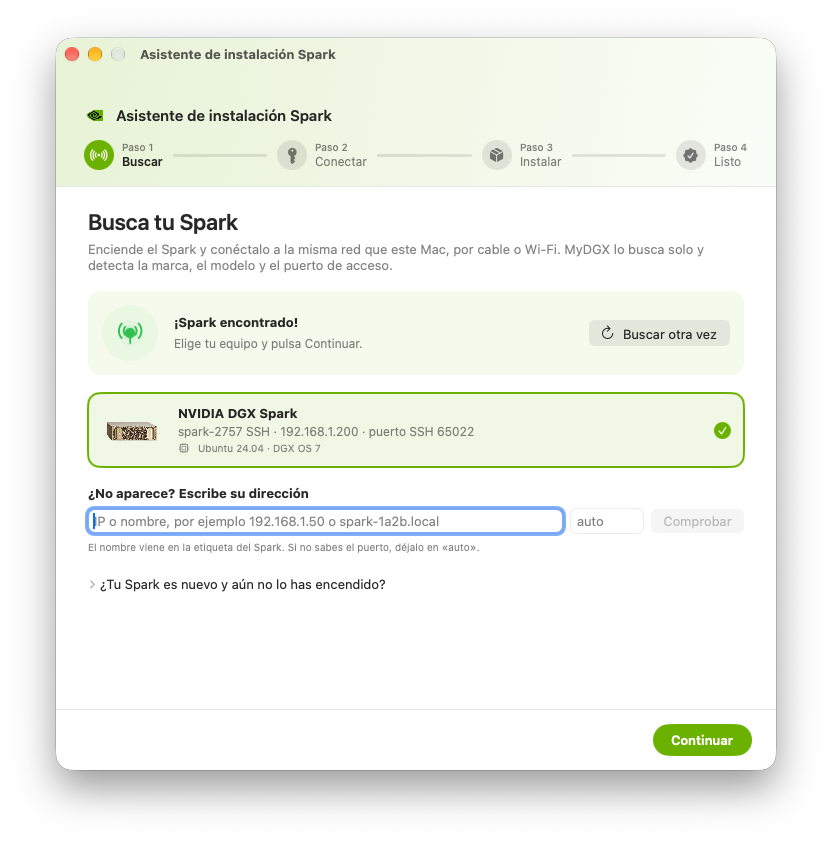
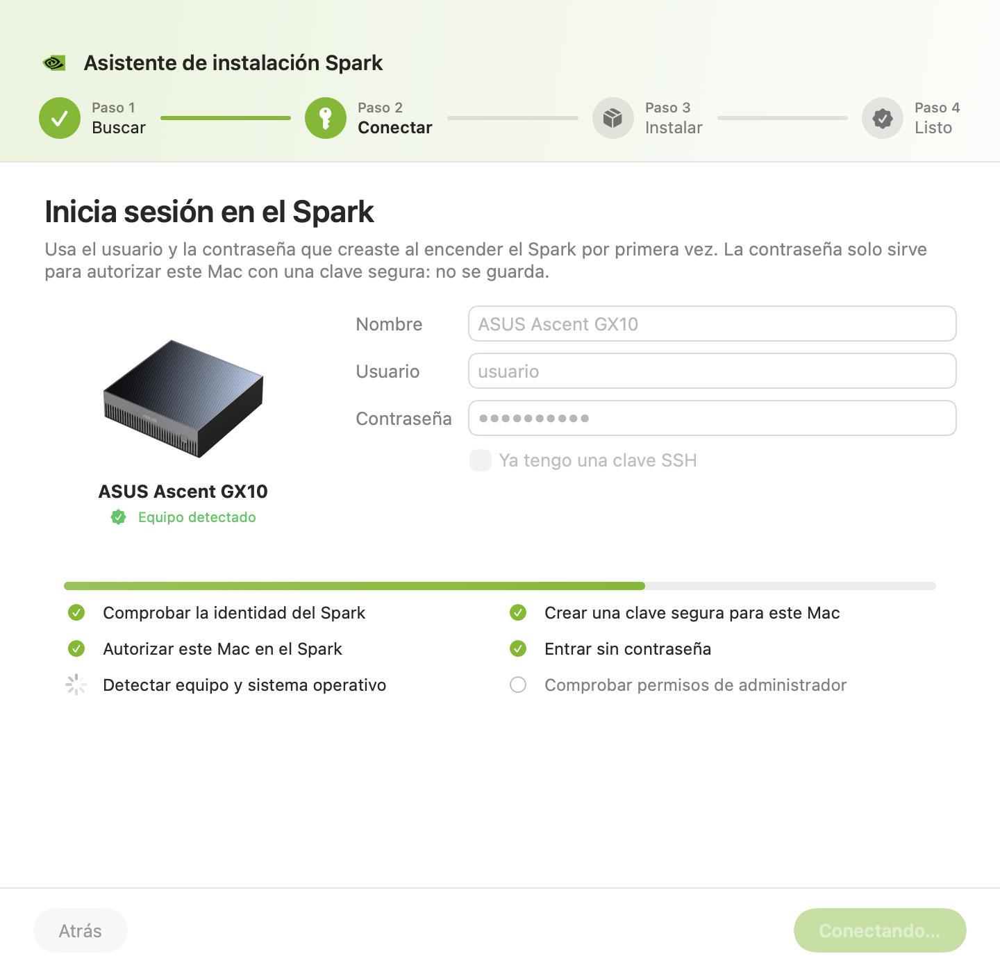
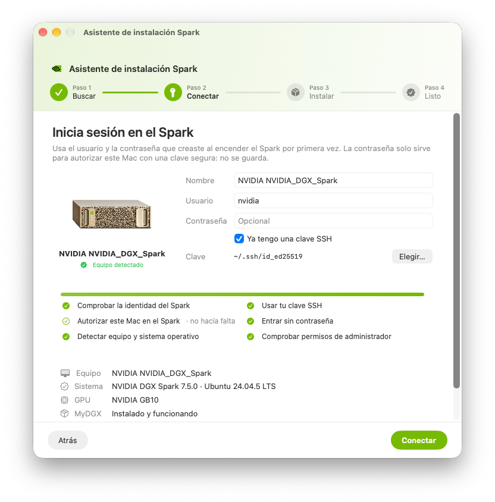
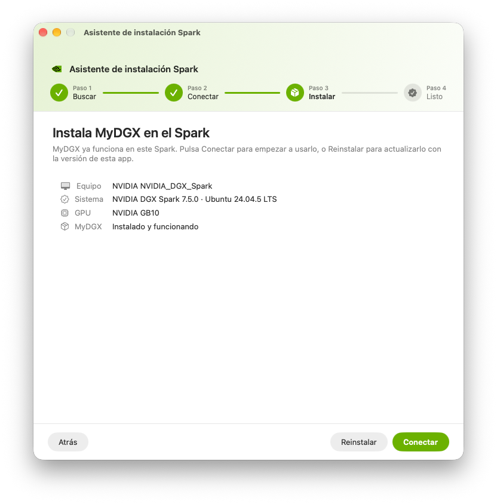
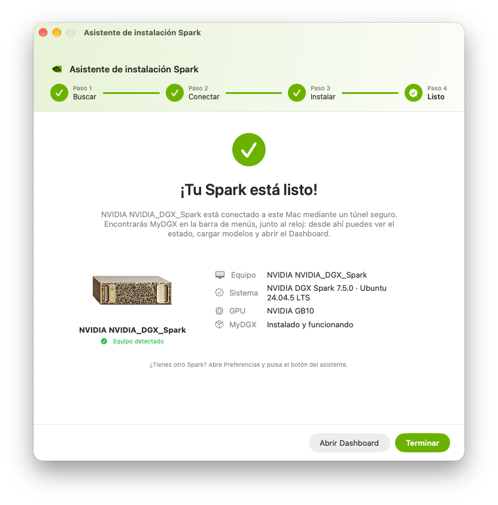

# Inicio rápido: instalar MyDGX desde macOS

Esta guía está pensada para usuarios sin experiencia técnica. La primera vez que
abres MyDGXTray se abre solo el **Asistente de instalación Spark**: encuentra el
Spark, lo conecta, instala MyDGX y te deja listo para usarlo, sin abrir Terminal.

## Resumen

1. Descarga MyDGXTray desde [Releases](https://github.com/yadox666/MyDGX/releases)
   y muévela a `Aplicaciones`.
2. Ábrela. El asistente aparece automáticamente y en el menú solo verás
   **Asistente de instalación Spark…** hasta terminarlo.
3. Sigue sus cuatro pasos: **Buscar**, **Conectar**, **Instalar** y **Listo**.
4. Pulsa **Abrir Dashboard**.

No necesitas descargar el código fuente, instalar Homebrew ni Node.js: la
aplicación incluye MyDGX y el Spark compila lo demás.

## Antes de empezar

Necesitas:

- un Mac con macOS 13 o posterior, con Apple Silicon o Intel;
- un DGX Spark con su primer arranque oficial ya completado;
- el usuario y la contraseña creados en el Spark (el usuario debe poder usar
  `sudo`);
- ambos equipos en la misma red, o una dirección SSH remota accesible;
- conexión a Internet durante la primera instalación.

No abras los puertos del dashboard, Open WebUI o ComfyUI en el router. Para una
conexión remota basta con SSH; MyDGXTray crea los túneles necesarios.

## 1. Descarga desde GitHub

1. Abre [Releases](https://github.com/yadox666/MyDGX/releases) en GitHub.
2. Descarga `MyDGXTray-<versión>-macos-universal.zip` y, si quieres comprobar la
   descarga, también su `.sha256`.
3. Descomprímelo y mueve **MyDGXTray** a `Aplicaciones`. La aplicación ya
   incluye MyDGX: no necesitas descargar el código fuente.
4. Abre MyDGXTray. Si macOS la bloquea la primera vez, ve a **Ajustes del
   Sistema › Privacidad y seguridad** y pulsa **Abrir igualmente**.

Para comprobar la descarga desde Terminal, en la carpeta de Descargas:

```bash
shasum -a 256 -c MyDGXTray-*-macos-universal.zip.sha256
```

Debe responder `OK`. Si prefieres compilarla tú, sigue el
[README de MyDGXTray](../macos/MyDGXTray/README.md).

## 2. Paso 1 · Buscar

### Permiso de red local

La primera vez, el asistente explica que macOS va a pedir permiso y espera a que
pulses **Buscar mi Spark**. Entonces aparece el aviso del sistema:

> «MyDGX Tray» quiere buscar dispositivos en tus redes locales.

Pulsa **Permitir**. Desde macOS 15 este permiso es obligatorio para cualquier app
que busque o conecte con equipos de tu red, incluidos los `ssh` que lanza
MyDGXTray, y solo se pregunta una vez. Sin él, la app no puede encontrar el Spark
ni conectarse a él por la red local. Si lo denegaste, el asistente lo detecta y
ofrece **Abrir Ajustes de Red local**: activa **MyDGX Tray** en **Ajustes del
Sistema › Privacidad y seguridad › Red local** y pulsa **Buscar otra vez**.

### Elegir el Spark

El asistente busca el Spark en tu red durante unos segundos y lo muestra con su
marca y modelo (NVIDIA, ASUS, Lenovo, HP…), su dirección, el puerto SSH y, si se
puede saber antes de entrar, el sistema operativo.

- Si aparece, selecciónalo (ya viene marcado si solo hay uno) y pulsa
  **Continuar**.
- Si no aparece, escribe su IP o su nombre de red (viene en la etiqueta, por
  ejemplo `spark-1a2b.local`) y pulsa **Comprobar**. Deja el puerto en «auto»
  salvo que sepas que es otro: se prueban 22, 65022 y 2222.
- ¿Spark nuevo sin encender? Despliega **¿Tu Spark es nuevo…?** para abrir la
  guía oficial de NVIDIA o preparar un USB OEMDATA.



## 3. Paso 2 · Conectar

Escribe el usuario y la contraseña que creaste en el primer arranque del Spark y
pulsa **Conectar**. Una lista con barra de progreso muestra cada comprobación:

1. Guarda la identidad del Spark (su huella SSH) en `~/.MyDGX/known_hosts`.
2. Crea una clave Ed25519 solo para este Mac en `~/.MyDGX/keys`.
3. Autoriza esa clave en el Spark usando la contraseña una única vez.
4. Entra ya sin contraseña.
5. Detecta la marca, el modelo y el sistema operativo (DGX OS o Ubuntu).
6. Comprueba que el usuario puede administrar el equipo (`sudo`).

Si ya tienes una clave SSH autorizada, marca **Ya tengo una clave SSH** y elígela;
la contraseña pasa a ser opcional. El nombre del equipo se rellena con el modelo
detectado y puedes cambiarlo.



Con una clave propia, la lista marca **no hacía falta** en la autorización y debajo
aparece lo detectado: equipo, sistema, GPU y estado de MyDGX.



## 4. Paso 3 · Instalar

Pulsa **Instalar MyDGX**. La barra de progreso muestra el porcentaje, la fase
actual (copiar MyDGX, preparar el sistema, compilar el motor de IA, instalar apps
y servicios, arrancar y comprobar) y el tiempo transcurrido. La primera vez tarda
entre 20 y 40 minutos; el Mac no entra en reposo mientras tanto.

Al terminar, el asistente guarda el perfil, abre el túnel SSH, importa la clave
API del dashboard y comprueba que todo responde. Si MyDGX ya estaba instalado y
funcionando, verás **Conectar** (y **Reinstalar** para actualizarlo).

Si algo falla, pulsa **Ver registro detallado** o **Reintentar**: lo ya instalado
se conserva.



## 5. Paso 4 · Listo

El asistente muestra un resumen del equipo. Pulsa **Abrir Dashboard** o
**Terminar**; el menú de MyDGXTray ya aparece completo. Desde él puedes abrir Open
WebUI, ComfyUI, Terminal SSH y las aplicaciones web de los perfiles.



Si el administrador activó una contraseña web, introdúcela en la pantalla de
inicio de sesión del dashboard.

### Otro Spark o un servidor remoto

Abre **Preferencias** y pulsa la **varita mágica**: es el mismo asistente. Para un
servidor remoto escribe en el paso 1 su dominio o IP pública y su puerto SSH.
Si el Spark ya estaba añadido, el asistente lo reconoce por su huella SSH, su
nombre de host o su dirección y puerto. En ese caso actualiza el perfil existente
en vez de duplicarlo. Después puedes añadir una **IP o hostname público** con el **puerto público/NAT**
en Preferencias; el Tray prueba primero la LAN y cambia a Internet si no
responde. Es preferible acceder mediante VPN. Si publicas SSH directamente, usa
autenticación por clave, desactiva contraseñas después de verificar el acceso y
limita el origen con el firewall.

## Actualizaciones posteriores

Instala la nueva versión de MyDGXTray desde Releases, sustituyendo la anterior
en `Aplicaciones`, y usa:

**Preferencias → Despliegue → Guardar y desplegar**

Se desplegará la versión de MyDGX incluida en la nueva aplicación.

Este despliegue es incremental: conserva `.env`, bases de datos, modelos,
credenciales y cachés del Spark.

### Dirección pública estable con DuckDNS

Opcionalmente puedes definir `DUCKDNS_DOMAIN` y `DUCKDNS_TOKEN` directamente en
el `.env` del Spark y ejecutar en el Mac, desde la copia que MyDGXTray deja en
`~/.MyDGX/source` tras el primer despliegue:

```bash
cd ~/.MyDGX/source
./start.sh deploy usuario@spark -p PUERTO_SSH -i RUTA_CLAVE --duckdns --repair --interactive
```

Usa el usuario, el host, el puerto y la ruta de la clave privada que aparecen en
la sección SSH del perfil en Preferencias.

MyDGX instalará un temporizador que actualiza DuckDNS al arrancar y cada hora.
Después usa `tu-nombre.duckdns.org` como **IP o hostname público** del perfil.

## Si algo falla

- **No encuentra el Spark:** comprueba el permiso de **Red local** (ver Paso 1),
  introduce manualmente la IP y verifica que SSH esté activo y que ambos equipos
  puedan comunicarse.
- **«El Spark no acepta contraseña por SSH»:** usa **Ya tengo una clave SSH**.
- **«La identidad del Spark no coincide»:** si lo reinstalaste, borra su línea de
  `~/.MyDGX/known_hosts` y vuelve a conectar.
- **Undeployed:** abre el asistente desde Preferencias o usa
  **Primer despliegue completo…**.
- **Autenticación requerida:** espera unos segundos; el Tray sincroniza su clave
  API mediante SSH. El dashboard web puede pedir una contraseña independiente.
- **El despliegue falla:** pulsa **Ver registro detallado** en el asistente o
  **Abrir log** en la tarjeta de progreso de Preferencias.
- **El túnel no conecta:** verifica host, puerto, usuario y clave SSH en
  Preferencias.

## SECURITY NOTES

- No copies contraseñas, tokens ni claves privadas dentro del repositorio.
- No publiques directamente los puertos 8088, 3000, 4000 u 8188 en Internet.
- El asistente guarda la huella SSH del Spark la primera vez y la exige después;
  en redes no confiables compárala con `ssh-keygen -lf /etc/ssh/ssh_host_ed25519_key.pub`
  ejecutado en el propio Spark.
- La contraseña del Spark solo vive en memoria mientras el asistente la usa. En el
  Mac llega a `ssh` por una FIFO privada; al Spark viaja por la entrada estándar de
  SSH y `sudo` la lee de un archivo 0600 en `/dev/shm` (RAM) que se borra al
  terminar o fallar. Nunca va en argumentos, variables de entorno ni registros.
- MyDGXTray guarda las API keys en `~/.MyDGX/credentials` y las claves SSH en
  `~/.MyDGX/keys`, con permisos restrictivos.
