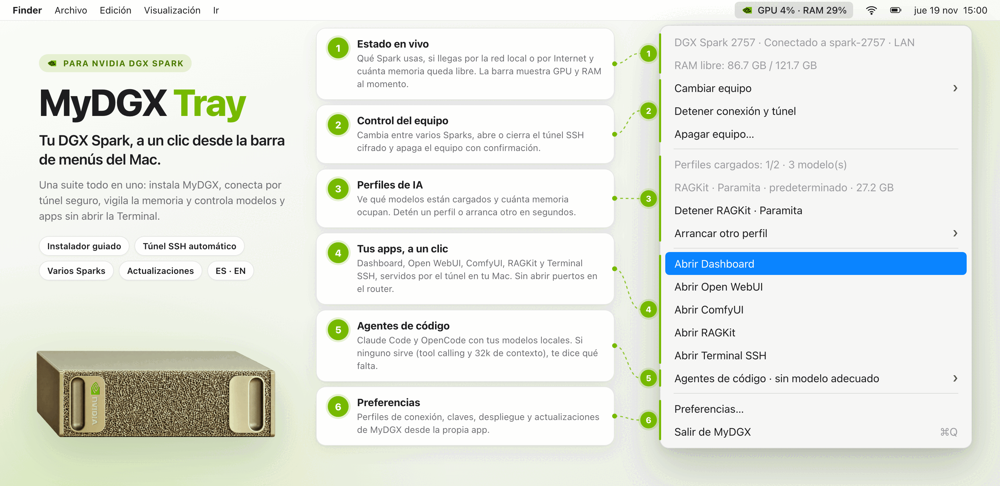
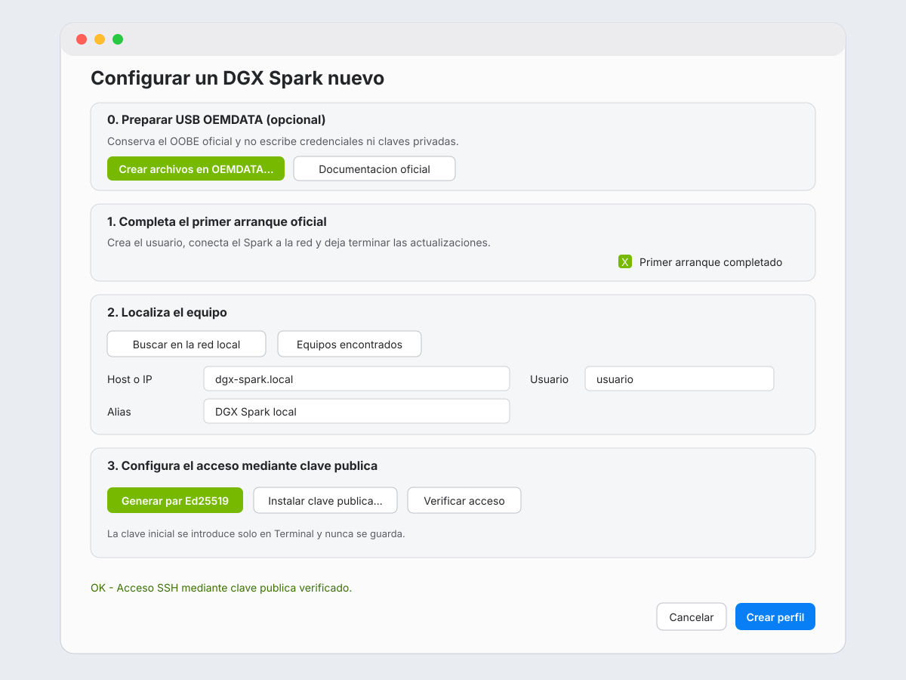

# MyDGX Tray para macOS

Cliente nativo de barra de menús para un equipo con MyDGX. Muestra GPU y memoria,
abre el dashboard, Open WebUI y SSH, activa perfiles de inferencia y permite un
apagado remoto confirmado.

## Vista de la aplicación

### Menú de la barra



El [README principal](../../README.es.md#mydgx-tray-tu-spark-desde-la-barra-de-menús)
explica cada bloque del menú.

### Preferencias y perfiles


### Configuración de un DGX Spark nuevo



## Compilar

La aplicación puede ejecutarse en macOS 13 o posterior. Para compilarla se
necesita Swift 6 (`swift-tools-version: 6.0`), incluido en Xcode 16 o en unas
Command Line Tools equivalentes. Comprueba el toolchain antes de compilar:

```bash
swift --version
```

```bash
cd macos/MyDGXTray
./scripts/build-app.sh
open dist/MyDGXTray.app
```

Para instalarla, copia `dist/MyDGXTray.app` a `/Applications`. La aplicación se
firma localmente de forma ad hoc; para distribuirla a otros Mac debe firmarse con
Developer ID y notarizarse.

### Descargar la versión compilada

Cada [Release](https://github.com/yadox666/MyDGX/releases) incluye
`MyDGXTray-<versión>-macos-universal.zip` (Apple Silicon e Intel, macOS 13 o
posterior) y su `.sha256`. Comprueba el hash, descomprime y mueve la app a
`/Applications`:

```bash
shasum -a 256 -c MyDGXTray-*-macos-universal.zip.sha256
ditto -x -k MyDGXTray-*-macos-universal.zip /Applications
```

La aplicación incluye el código de MyDGX de la misma versión, así que no hace
falta descargar el repositorio para desplegar: deja vacío **Proyecto local** en
Preferencias.

Mientras la Release esté firmada de forma ad hoc, macOS la bloquea en el primer
arranque. Ábrela una vez, ve a **Ajustes del Sistema › Privacidad y seguridad** y
pulsa **Abrir igualmente**.

### Actualizar desde la app

En **Preferencias › Aplicación** aparece la versión instalada y el botón
**Buscar actualizaciones**. La app también lo comprueba al arrancar y una vez al
día; si hay una Release `tray-v*` más nueva, el menú muestra **Actualización
disponible** y Preferencias ofrece **Descargar e instalar**. La app descarga el
zip por HTTPS y comprueba su `.sha256`. Después verifica el identificador del
paquete, la versión y la firma con `codesign --verify --deep --strict`. Si todo
cuadra, envía la versión actual a la Papelera, coloca la nueva en el mismo sitio
y se reinicia. La carpeta de la app tiene que tener permiso de escritura, como
`/Applications` para un administrador. Desde la terminal:

```bash
MyDGXTray.app/Contents/MacOS/MyDGXTray --check-for-updates   # solo informa
MyDGXTray.app/Contents/MacOS/MyDGXTray --install-update      # instala si hay versión nueva
```

### Empaquetar una Release

```bash
./scripts/package-release.sh
```

Genera el binario universal, incluye el proyecto del commit actual
(`git archive HEAD`, sin archivos sin versionar como `.env`) y deja el zip y el
hash en `dist/`. Se niega a empaquetar con cambios sin commit para que la app
no lleve código distinto del publicado. Para firmar con
Developer ID y notarizar, define `MYDGX_SIGN_IDENTITY` con el nombre del
certificado y `MYDGX_NOTARY_PROFILE` con un perfil creado con
`xcrun notarytool store-credentials`; las credenciales de Apple quedan en el
Llavero y nunca en el repositorio.

## Configuración

En el primer arranque se crea una instalación de usuario autosuficiente:

```text
~/.MyDGX/
├── config
├── known_hosts
├── keys/
├── credentials/
├── certificates/
├── backups/
├── logs/
├── run/
├── source/          copia de MyDGX incluida en la app, usada al desplegar
└── bin/
    ├── mydgx-ssh
    ├── mydgx-tunnel
    └── mydgx-deploy
```

`config` contiene varios perfiles de conexión y el identificador del perfil activo.
Cada perfil tiene alias, tipo, API, Open WebUI, SSH, túnel y despliegue. La aplicación
migra automáticamente el antiguo formato de un solo equipo.

Consulta [`PREFERENCIAS.md`](PREFERENCIAS.md) para ver el significado, los valores
válidos y ejemplos de configuración de todos los campos de Preferencias.

Las API keys no aparecen en el JSON: Preferencias las guarda en
`~/.MyDGX/credentials` con permisos `0600`, separadas por perfil. Las claves privadas se referencian por ruta; si
quieres una instalación portable, colócalas manualmente en `~/.MyDGX/keys` con
permisos `0600`. Las CA privadas pueden guardarse en `~/.MyDGX/certificates`.

Para una conexión directa por LAN, MyDGX debe escuchar en una dirección accesible
desde el Mac y tener `MYDGX_API_KEY` configurada. Con el túnel SSH administrado,
el Tray reenvía el panel, Open WebUI y el gateway de modelos. MyDGX puede
permanecer ligado a `127.0.0.1` y la clave API es opcional. Es
preferible usar el túnel o publicar el servicio detrás de HTTPS; no expongas
directamente Ollama, Docker ni otros servicios.

## Primer acceso a un DGX Spark nuevo

Si todavía no hay ningún Spark configurado (primera instalación, sin
`~/.MyDGX/config`), MyDGXTray abre el **Asistente de instalación Spark** y su menú
solo ofrece ese asistente y Salir. El mismo asistente se abre desde la varita de
Preferencias para añadir otros Sparks, o con `--setup-assistant`.

Las capturas de `docs/es/quickstart.md` se generan sin red ni permisos de pantalla,
con datos de ejemplo y un `HOME` aislado:

```bash
mkdir -p .build/screenshot-home
HOME="$PWD/.build/screenshot-home" CFFIXED_USER_HOME="$PWD/.build/screenshot-home" \
  ./dist/MyDGXTray.app/Contents/MacOS/MyDGXTray --render-setup-screenshots ../../docs/images
```

Desde macOS 15 la app necesita el permiso **Red local** (Bonjour y conexiones SSH
a la LAN). El asistente lo explica antes de que aparezca el aviso, detecta si se
deniega y abre el panel de Ajustes correspondiente. `Info.plist` declara los
servicios Bonjour que usa (`_ssh._tcp`, `_sftp-ssh._tcp`, `_workstation._tcp`).

1. **Buscar.** Bonjour (`_ssh._tcp`, `_sftp-ssh._tcp`, `_workstation._tcp`) o
   IP/hostname manual. Prueba los puertos 22, 65022 y 2222, lee el banner SSH para
   anticipar el sistema y deduce marca y modelo del nombre (spark, gx10, pgx,
   zgx, promax…). Incluye la guía oficial de primer arranque y la preparación de un USB
   `OEMDATA` (solo `meta-data` y `user-data`, sin credenciales).
2. **Conectar.** Guarda la huella del host en `~/.MyDGX/known_hosts` y desde ahí
   usa `StrictHostKeyChecking=yes`. Genera un par Ed25519 en `~/.MyDGX/keys`, lo
   autoriza con la contraseña sin abrir Terminal (`SSH_ASKPASS` servido por una
   FIFO 0600 de un solo uso), verifica el acceso por clave y lee DMI,
   `/etc/os-release` y `/etc/dgx-release` para identificar el modelo y DGX OS
   o Ubuntu. También comprueba `sudo`. Admite una clave SSH existente.
3. **Instalar.** Ejecuta `start.sh deploy … --repair --sudo-password-stdin` desde
   la fuente incluida, con barra de progreso por fases (incluido el porcentaje de
   compilación de llama.cpp), registro en `~/.MyDGX/logs/setup-*.log` y sin
   reposo del Mac. Si MyDGX ya funciona, ofrece Conectar o Reinstalar.
4. **Listo.** Guarda el perfil (sustituye el perfil vacío inicial), abre el túnel,
   importa la clave API y comprueba la API antes de mostrar el resumen.

`--sudo-password-stdin` lee la contraseña de la entrada estándar, la reenvía por
la entrada estándar de SSH y en el Spark la sirve a `sudo -A` desde un archivo
0600 en `/dev/shm` que se borra al terminar. Nunca usa argumentos, variables de
entorno ni el registro. **Primer despliegue completo…** sigue disponible como
alternativa con Terminal (`--interactive`). Para actualizaciones posteriores usa
**Guardar y desplegar**, que trabaja sin interacción mediante las reglas `sudoers`
limitadas instaladas durante el primer despliegue.

La guía completa para usuarios nuevos está en
[`docs/es/quickstart.md`](../../docs/es/quickstart.md).

## Acciones remotas

- **Cambiar equipo** selecciona el perfil activo por alias.
- **Agentes de código** abre Terminal con SSH al perfil activo y ejecuta
  `start.sh claude` u `start.sh opencode` desde el directorio remoto de MyDGX.
  Cada script cambia a su workspace (`~/claude-code` u `~/opencode`) e instala el
  CLI si falta. Hay dos modos: plan, de solo lectura, y edición con `--active`.
  Solo se pueden abrir si el gateway publica un modelo de chat o visión con tool
  calling y al menos 32k de contexto. Si no lo hay, el submenú explica qué falta
  y deja las opciones deshabilitadas. La comprobación se repite al pulsar.
- **Selección automática:** al arrancar, y cuando el perfil activo deja de responder,
  la app comprueba el SSH de todos los perfiles. Usa primero un equipo encendido en
  la red local y, si no hay ninguno, uno accesible por internet (host público).
  Durante dos minutos después de que elijas un perfil a mano, no lo cambia.
- **Iniciar conexión** levanta el túnel SSH configurado y actualiza la telemetría.
- **Abrir <alias>** aparece por cada app web de un perfil que esté en
  marcha en el DGX (alias y puerto se configuran en el editor de perfiles). Con
  túnel, reenvía `127.0.0.1:<puerto>` del Mac al mismo puerto del DGX, lo mantiene
  mientras la app siga en marcha y abre el navegador. El puerto debe estar libre
  en el Mac.
- **Terminal SSH** crea un lanzador por perfil en `~/.MyDGX/bin` y utiliza la clave,
  puerto y `known_hosts` centralizados.
- **Preferencias → Guardar y desplegar** sincroniza el proyecto con `rsync`,
  excluye secretos, datos y dependencias locales, y ejecuta
  `scripts/deploy-from-tray.sh`. El script prepara MyDGX, instala o actualiza Open
  WebUI en el usuario remoto, configura sus URLs locales, reinicia MyDGX y el
  gateway y espera hasta cinco minutos a que Open WebUI responda. No sustituye al
  aprovisionamiento completo del sistema operativo.
- **Preferencias → Despliegue → Actualizar desde GitHub (main)…**, en cada DGX,
  pide confirmación, guarda y abre Terminal con
  `start.sh deploy --github main --interactive` sobre ese equipo.
  Despliega el último commit publicado en `origin/main`, no los cambios locales,
  con copia de seguridad y vuelta atrás si falla. Requiere que *Proyecto local*
  apunte a un clon git de MyDGX; con el código incluido en la app queda
  desactivado.
- **Copia de Seguridad DGX** crea en `~/.MyDGX/backups/<alias>/<fecha>/` una
  instantánea consistente de `mydgx.db` y de los datos de Open WebUI. No copia
  `.env`, claves SSH, modelos ni cachés.
- **Apagar** usa `/usr/bin/ssh` en modo no interactivo y autenticación por clave.
  Requiere una regla sudoers limitada al comando `/usr/sbin/shutdown -h now`; no
  concedas `NOPASSWD: ALL`.

Para restaurar una base MyDGX durante el despliegue:

```bash
./start.sh deploy --database ~/.MyDGX/backups/ALIAS/FECHA/mydgx.db
```

La base se valida antes de transferirla, se detienen los servicios para sustituirla
atómicamente y se conserva la base remota anterior hasta que termine el despliegue.

## SECURITY NOTES:

- No guardes claves privadas, API keys ni contraseñas dentro del repositorio.
- Usa HTTPS con un certificado válido o una CA privada fijada en la configuración.
- Restringe la API por firewall a los equipos administradores.
- Prepara únicamente reglas `sudoers` para los comandos fijos documentados; el
  Tray no funciona con contraseñas sudo interactivas y nunca debe recibir
  `NOPASSWD: ALL`.
- Revisa las operaciones en el registro de auditoría de MyDGX.
