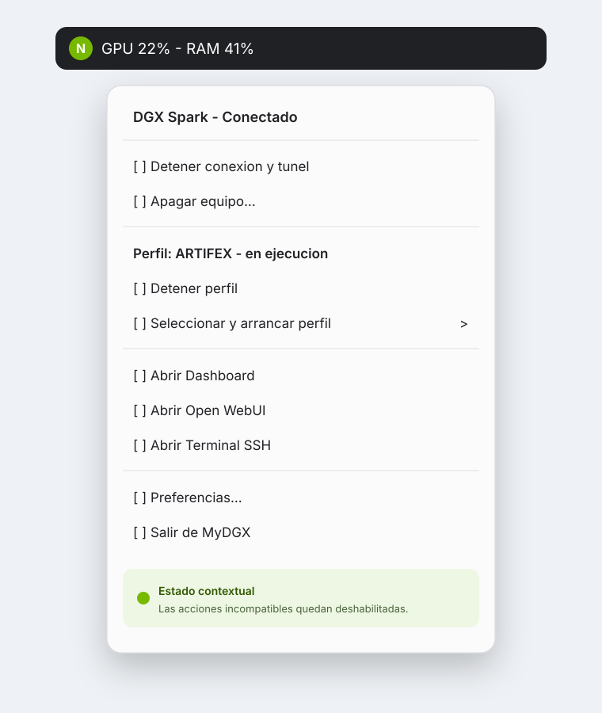
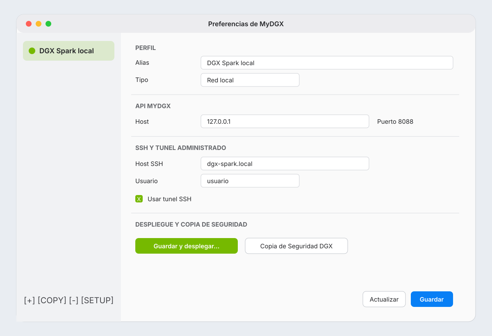

# MyDGX Tray para macOS

Cliente nativo de barra de menús para un equipo con MyDGX. Muestra GPU y memoria,
abre el dashboard, Open WebUI y SSH, activa perfiles de inferencia y permite un
apagado remoto confirmado.

## Vista de la aplicación

### Menú de la barra



### Preferencias y perfiles



### Configuración de un DGX Spark nuevo


## Compilar

La aplicación puede ejecutarse en macOS 13 o posterior. Para compilarla se
necesita Swift 6 (`swift-tools-version: 6.0`), incluido en Xcode 16 o en unas
Command Line Tools equivalentes. Comprueba el toolchain antes de compilar:

```bash
swift --version
```

```bash
cd macos/MyDGXTray
./scripts/build-app.sh
open dist/MyDGXTray.app
```

Para instalarla, copia `dist/MyDGXTray.app` a `/Applications`. La aplicación se
firma localmente de forma ad hoc; para distribuirla a otros Mac debe firmarse con
Developer ID y notarizarse.

## Configuración

En el primer arranque se crea una instalación de usuario autosuficiente:

```text
~/.MyDGX/
├── config
├── known_hosts
├── keys/
├── credentials/
├── certificates/
├── backups/
├── logs/
└── bin/
    ├── mydgx-ssh
    ├── mydgx-tunnel
    └── mydgx-deploy
```

`config` contiene varios perfiles de conexión y el identificador del perfil activo.
Cada perfil tiene alias, tipo, API, Open WebUI, SSH, túnel y despliegue. La aplicación
migra automáticamente el antiguo formato de un solo equipo.

Consulta [`PREFERENCIAS.md`](PREFERENCIAS.md) para ver el significado, los valores
válidos y ejemplos de configuración de todos los campos de Preferencias.

Las API keys no aparecen en el JSON: Preferencias las guarda en
`~/.MyDGX/credentials` con permisos `0600`, separadas por perfil. Las claves privadas se referencian por ruta; si
quieres una instalación portable, colócalas manualmente en `~/.MyDGX/keys` con
permisos `0600`. Las CA privadas pueden guardarse en `~/.MyDGX/certificates`.

Para una conexión directa por LAN, MyDGX debe escuchar en una dirección accesible
desde el Mac y tener `MYDGX_API_KEY` configurada. Con el túnel SSH administrado,
el Tray reenvía el panel, Open WebUI y el gateway de modelos. MyDGX puede
permanecer ligado a `127.0.0.1` y la clave API es opcional. Es
preferible usar el túnel o publicar el servicio detrás de HTTPS; no expongas
directamente Ollama, Docker ni otros servicios.

## Primer acceso a un DGX Spark nuevo

En Preferencias, pulsa el botón con la varita para abrir el asistente:

1. Opcionalmente, prepara un volumen FAT32 etiquetado `OEMDATA` para imágenes
   DGX Spark de octubre de 2026 o posteriores. MyDGX solo escribe `meta-data` y
   `user-data`, conserva el OOBE y no guarda credenciales.
2. Completa el primer arranque oficial con pantalla y teclado, o mediante el
   hotspot y portal cautivo indicados en la guía rápida de NVIDIA.
3. Crea el usuario, conecta el Spark a una red estable y espera a que terminen las
   actualizaciones sin apagarlo.
4. Busca el Spark mediante mDNS/Bonjour (`_ssh._tcp`) o introduce su hostname/IP.
5. Genera un par Ed25519 dedicado en `~/.MyDGX/keys`.
6. Instala la clave pública. Terminal solicitará una sola vez la contraseña creada
   en el primer arranque; la aplicación nunca la recibe ni la guarda.
7. Verifica el acceso sin contraseña. Solo después se habilita la creación del
   perfil.

El asistente registra la clave del host en `~/.MyDGX/known_hosts`. Tras crear el
perfil, selecciona el proyecto local. En un Spark nuevo usa **Primer despliegue
completo…**: el Tray abre Terminal para confirmar la huella y solicitar `sudo`
directamente, sin recibir ni guardar la contraseña. Esta operación prepara las
dependencias, CUDA, llama.cpp, Docker y los servicios. Para actualizaciones
posteriores usa **Guardar y desplegar**, que trabaja sin interacción mediante
las reglas `sudoers` limitadas instaladas durante el primer despliegue.

La guía completa para usuarios nuevos está en
[`docs/quickstart.md`](../../docs/quickstart.md).

## Acciones remotas

- **Cambiar equipo** selecciona el perfil activo por alias.
- **Iniciar conexión** levanta el túnel SSH configurado y actualiza la telemetría.
- **Abrir <alias>** aparece por cada app web de un perfil que esté en
  marcha en el DGX (alias y puerto se configuran en el editor de perfiles). Con
  túnel, reenvía `127.0.0.1:<puerto>` del Mac al mismo puerto del DGX, lo mantiene
  mientras la app siga en marcha y abre el navegador. El puerto debe estar libre
  en el Mac.
- **Terminal SSH** crea un lanzador por perfil en `~/.MyDGX/bin` y utiliza la clave,
  puerto y `known_hosts` centralizados.
- **Preferencias → Guardar y desplegar** sincroniza el proyecto con `rsync`,
  excluye secretos, datos y dependencias locales, y ejecuta
  `scripts/deploy-from-tray.sh`. El script prepara MyDGX, instala o actualiza Open
  WebUI en el usuario remoto, configura sus URLs locales, reinicia MyDGX y el
  gateway y espera hasta cinco minutos a que Open WebUI responda. No sustituye al
  aprovisionamiento completo del sistema operativo.
- **Copia de Seguridad DGX** crea en `~/.MyDGX/backups/<alias>/<fecha>/` una
  instantánea consistente de `mydgx.db` y de los datos de Open WebUI. No copia
  `.env`, claves SSH, modelos ni cachés.
- **Apagar** usa `/usr/bin/ssh` en modo no interactivo y autenticación por clave.
  Requiere una regla sudoers limitada al comando `/usr/sbin/shutdown -h now`; no
  concedas `NOPASSWD: ALL`.

Para restaurar una base MyDGX durante el despliegue:

```bash
./start.sh deploy --database ~/.MyDGX/backups/ALIAS/FECHA/mydgx.db
```

La base se valida antes de transferirla, se detienen los servicios para sustituirla
atómicamente y se conserva la base remota anterior hasta que termine el despliegue.

## SECURITY NOTES:

- No guardes claves privadas, API keys ni contraseñas dentro del repositorio.
- Usa HTTPS con un certificado válido o una CA privada fijada en la configuración.
- Restringe la API por firewall a los equipos administradores.
- Prepara únicamente reglas `sudoers` para los comandos fijos documentados; el
  Tray no funciona con contraseñas sudo interactivas y nunca debe recibir
  `NOPASSWD: ALL`.
- Revisa las operaciones en el registro de auditoría de MyDGX.
